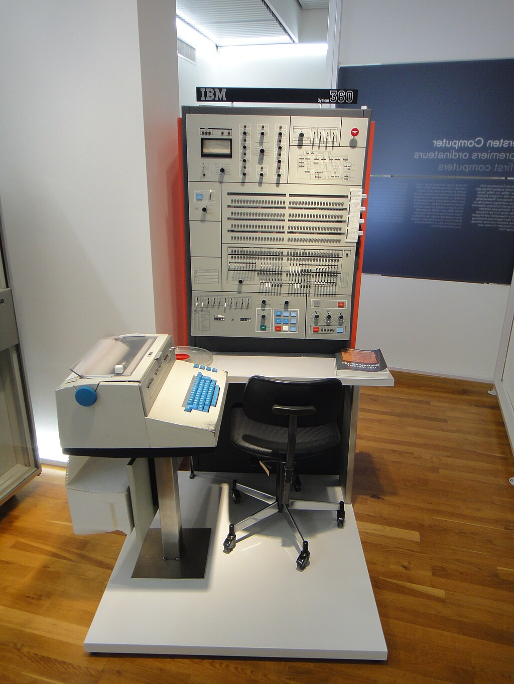
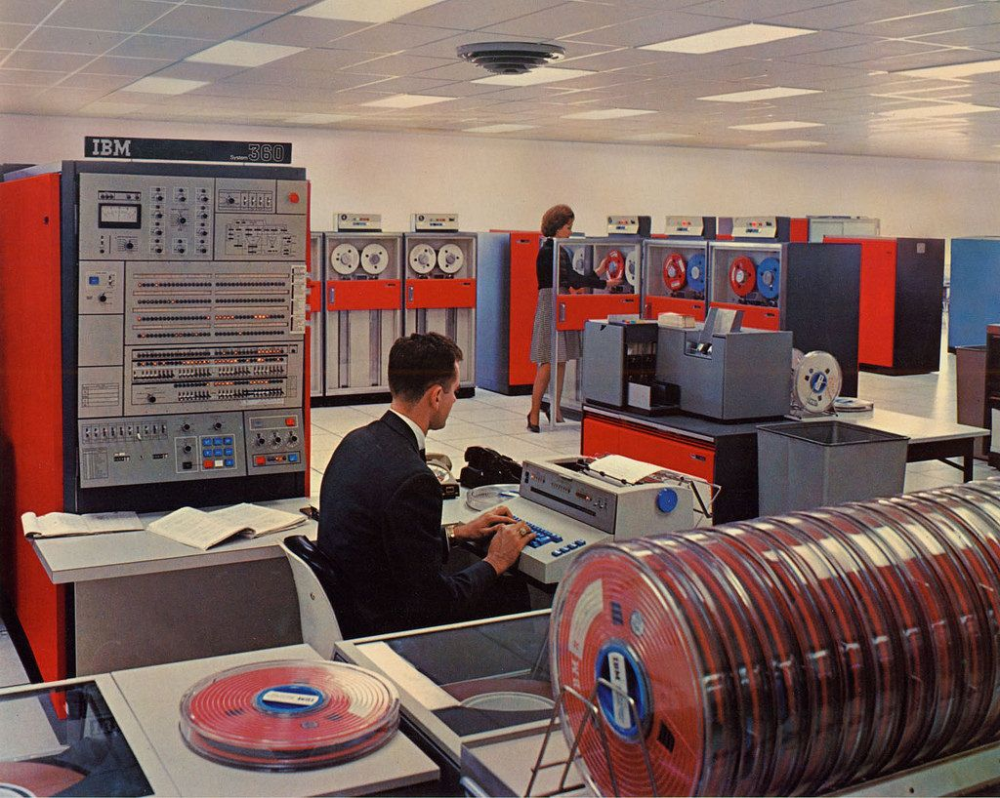

# Virtualization

Virtualization is a technology that creates multiple simulated environments — or dedicated resource partitions — from a single physical hardware system. In effect, one physical machine can behave as if it were several independent machines, each running its own operating system and applications.

The three main categories of virtualization are:

- **Hardware Virtualization** — running multiple virtual machines on a single physical host
- **Operating System Virtualization** — isolating applications in lightweight containers that share a single OS kernel
- **Network Virtualization** — abstracting physical network resources into software-defined logical networks

Virtualization has fundamentally changed how infrastructure is provisioned, how services are delivered, and how IT budgets are allocated. To understand why, it helps to look at the history that made it necessary.

## Virtualization History

### Mainframe Era

Mainframe computers emerged in the 1960s as the backbone of business computing. These powerful, room-sized machines handled vast amounts of data processing for large organizations such as banks, government agencies, and corporations.

One of the most significant mainframe series was the `IBM System/360`, which revolutionized computing by offering a family of machines with compatible software and hardware. This allowed a wide range of applications to run across different models in the same family.

### Batch Processing and Time-Sharing

Mainframes primarily ran **batch processing** jobs — a series of tasks executed without user interaction. Users submitted jobs via punch cards or magnetic tapes, and processing was scheduled for off-peak hours.

Early **time-sharing** systems improved on this by allowing multiple users to share computer resources concurrently. While primitive compared to later virtualization technologies, they introduced the foundational idea of dividing a single machine's resources among multiple users.

### The Birth of Virtualization

Virtualization began in the late 1960s with IBM's `CP-67/CMS`. This system enabled dynamic resource allocation and the ability to run multiple independent environments simultaneously on a single mainframe.

Throughout the 1970s and 1980s, IBM continued developing virtualization with the `VM/370`, which introduced more sophisticated capabilities such as virtual machine isolation and resource management. However, as personal computers (PCs) and smaller servers became more powerful and affordable, interest in mainframe-style virtualization declined.

### Decentralization of Computing Power

With the rise of PCs and departmental servers, businesses began moving away from mainframe-centric models. Localized computing resources were easier to manage and appeared more cost-effective in the short term.

Several factors contributed to the explosion of server deployments worldwide:

- The rise of Microsoft Windows as the dominant operating system
- Growing corporate reliance on networked services
- The expansion of the Internet and content-driven business channels

### Operating System Standardization

As companies transitioned from paper-based records to computerized systems for accounting, HR, and other functions, many early deployments ran vendor-specific operating systems, making interoperability difficult.

The limitations of proprietary platforms led to efforts to establish standards. **UNIX**, developed in 1969 at Bell Laboratories, became the first widely adopted standardized operating system, valued for its robustness and portability across hardware platforms. **Microsoft Windows**, introduced in the 1980s, eventually became the dominant PC operating system despite competition from CP/M and OS/2.

### Server Sprawl

As Windows-based PCs became widespread, IT departments needed to manage both Windows and non-Windows systems. Windows servers eventually became capable of hosting applications traditionally run on minicomputers and mainframes, but this transition introduced new challenges:

- **Single-user OS design** — Windows was originally designed for single-user operation, not for hosting multiple concurrent services.
- **Application conflicts** — Running multiple applications on a single server often caused resource contention and system failures.

To avoid conflicts, businesses adopted the **"One Server, One Application"** practice: each application received its own dedicated physical server.

Corporate politics further accelerated server growth. Departments insisted on dedicated IT infrastructure to maintain control over their data:

- **HR and Payroll** — Concerned about data security
- **Marketing, Finance, and Sales** — Needed to protect financial information
- **Research and Development** — Required secure environments for intellectual property

This led to redundant deployments — such as multiple email systems within a single company — increasing both operational complexity and costs. Meanwhile, Moore's Law and falling hardware prices made it easy for any department to acquire its own servers.

### From Computer Rooms to Data Centers

Early business computers were housed in specialized rooms with raised floors for cable management, dedicated power supplies, cooling systems, and fire suppression. As server counts grew, these rooms evolved into large-scale data centers.

By the late 1990s, the Internet transformed business operations. Companies rushed to establish an online presence, which led to an explosion in server deployments:

- Existing companies web-enabled legacy applications to serve customers online.
- New companies like Amazon and Google introduced business models that required massive server farms.

### Physical Limitations of Data Centers

As data centers expanded, they hit critical limits:

- **Space** — Facilities ran out of physical room for new servers.
- **Power** — Buildings could not support additional electrical loads.
- **Cooling** — Increased hardware density demanded more sophisticated cooling solutions.
- **Operational complexity** — IT teams struggled to maintain rapidly growing infrastructure.

In extreme cases, organizations lost track of servers entirely. A **lost server** is a machine that is still running, but no one knows which business unit owns it or what it does. These servers could not be shut down for fear of disrupting an unknown but potentially critical service.

Between 2000 and 2006, the U.S. Environmental Protection Agency (EPA) reported that energy consumption by data centers had doubled. Servers consumed about 2% of the country's total electricity, with cooling systems using an equal amount. These challenges made it clear that a more efficient approach to computing infrastructure was needed — setting the stage for the modern resurgence of virtualization.

## Server Replacement and Utilization

### Replacement Cycles

Servers are routinely replaced as part of IT infrastructure management. The two primary models are:

- **Purchase model** — Companies buy servers and replace them every three to five years once fully depreciated.
- **Lease model** — Companies lease servers and replace them when the lease expires, typically on the same three-to-five-year cycle.

### Sizing and Headroom

When a server is first purchased, it is sized based on the intended workload. For example, a server acquired to run a database is configured based on:

- The application vendor's recommended hardware specifications
- Current capacity needs **plus** future growth and emergency scenarios (known as `headroom`)

This extra capacity ensures the server remains viable for its full lifecycle without needing mid-cycle upgrades.

### The Impact of Moore's Law

When a server reaches the end of its lifecycle, it is typically replaced with a similar configuration. However, due to Moore's Law — which states that processing power roughly doubles every two years — the replacement hardware is dramatically more powerful.

| Year                | 2015 | 2016 | 2017     | 2018 | 2019     | 2020     |
|---------------------|------|------|----------|------|----------|----------|
| **Processor Speed** | 1x   | 2x   | 4x       | 4x   | 8x       | 16x      |
| **Three-year plan** | —    | —    | Purchase | —    | —        | Purchase |
| **Five-year plan**  | —    | —    | —        | —    | Purchase | —        |

- On a **three-year cycle**, after two replacements (years 3 and 6), the newest server is **16×** more powerful than the original.
- On a **five-year cycle**, the replacement at year 5 is still **8×** faster.
- Beyond CPU speed, newer servers also ship with more memory, faster storage, and improved I/O.

### The Utilization Problem

Despite these performance gains, actual workloads do not grow at the same rate as hardware capabilities. Servers originally provisioned with 20–50% headroom may end up with over 90% unused capacity after one or two refresh cycles.

Across a typical data center, average utilization is only 10–15%, and the distribution is uneven:

- A few servers run at high utilization.
- Most operate below 5%, meaning CPUs sit idle over 95% of the time.

### How Virtualization Helps

Hardware virtualization addresses this waste by allowing multiple virtual machines (VMs) to run on a single physical server. Instead of replacing underutilized machines with even more powerful ones that continue to sit idle, organizations can **consolidate** workloads onto fewer physical hosts using a hypervisor.

This reduces the total number of servers needed, lowers energy consumption, and dramatically improves CPU, memory, and storage utilization.

---

[Next: Hardware Virtualization →](02_hardware_virtualization.md)
