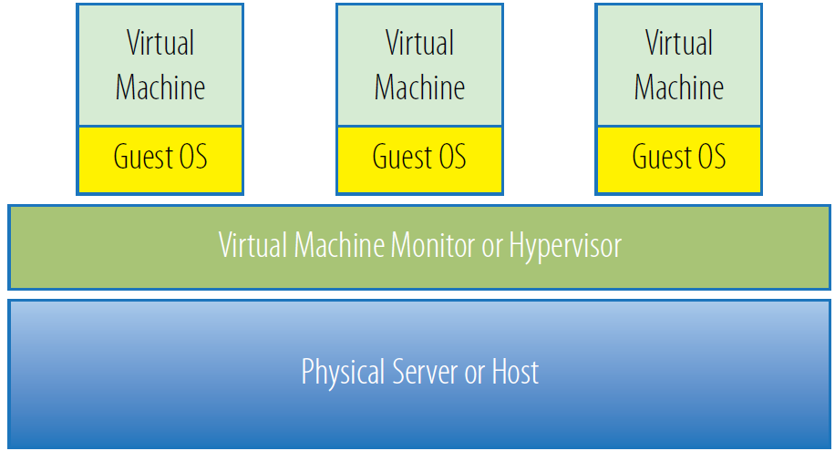
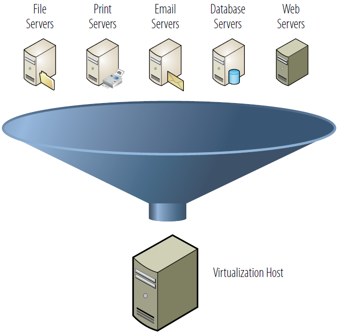
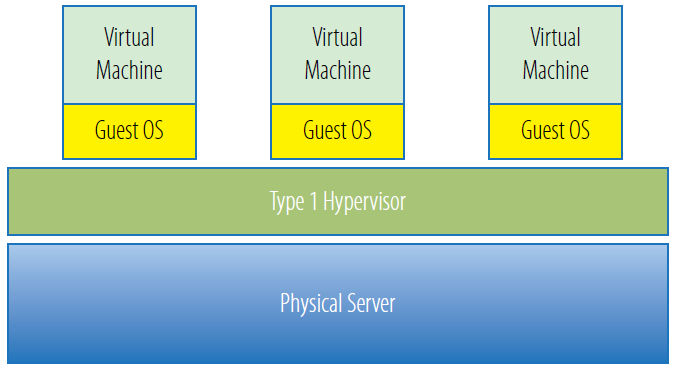
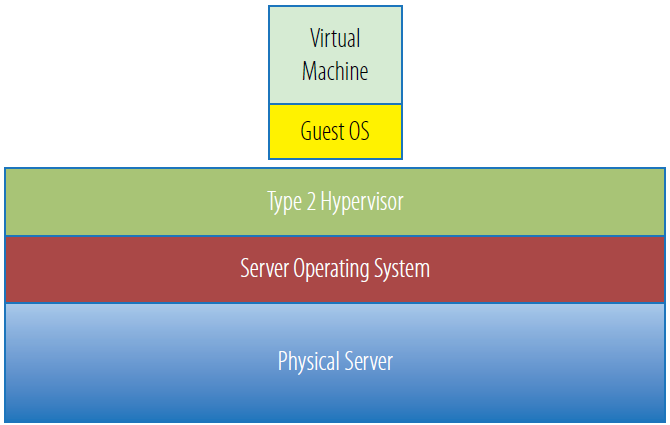

# Hardware Virtualization

Hardware virtualization allows multiple operating systems to run concurrently on the same physical server, with each workload isolated from the others. A software layer called a **hypervisor** sits between the hardware and the guest operating systems, managing resource allocation and enforcing isolation.

This chapter covers the theoretical foundations, hypervisor types, consolidation metrics, and the hardware-assisted features that make modern virtualization efficient.

## Theoretical Foundations

As covered in the [previous chapter](01_introduction.md), IBM pioneered practical virtualization in the 1960s with time-sharing mainframes. The formal theoretical framework came later, in 1974, when **Gerald J. Popek** and **Robert P. Goldberg** published *"Formal Requirements for Virtualizable Third Generation Architectures."* Their paper defined the conditions a system must meet to support virtualization:

- All hardware resources (CPU, memory, storage, and network) must be virtualizable.
- A **Virtual Machine Monitor** (VMM) must manage and allocate those resources.
- Each **Virtual Machine** (VM) must behave as an independent, fully functional computing environment.

Today, the VMM is commonly called a **hypervisor**.

For decades, virtualization remained associated primarily with mainframes. It was not until the early 2000s that it became widely available on x86 hardware:

- **VMware** released the first commercial x86 virtualization product in 2001, enabling enterprises to run multiple operating systems on standard server hardware.
- **Xen**, an open-source alternative, followed in 2003 and broadened access to virtualization technology.

## Consolidation Ratio

One of the most impactful benefits of hardware virtualization is **server consolidation** — reducing the number of physical servers by running multiple VMs on each remaining host.

The **consolidation ratio** measures how many VMs run per physical server. For example, a host running eight VMs has a consolidation ratio of **8:1**. Even a modest ratio of 4:1 eliminates three-quarters of a data center's physical servers.

Industry studies indicate that the total cost of ownership (TCO) for a single server is **3–10×** its purchase price over three years. For example, a $5,000 server may cost $20,000 to maintain over that period. Consolidating 100 such servers could save roughly **$2 million per year** in operational costs.

Early x86 hypervisors achieved consolidation ratios around 5:1. With advances in processor power and memory capacity, modern virtualization routinely enables:

- **10:1** — Removing nine out of ten physical servers
- **100:1** — Achievable in some configurations, removing 99 out of 100 servers

## Hypervisors

A hypervisor (also called a virtual machine monitor) is the software, firmware, or hardware layer that creates and manages virtual machines. Its key functions include:

- **Resource sharing** — Enabling multiple operating systems to share a single physical server
- **Isolation** — Ensuring that crashes, security breaches, or failures in one VM do not affect others
- **Dynamic allocation** — Distributing CPU, memory, storage, and network resources among VMs based on demand
- **Consolidation** — Running multiple workloads on fewer physical hosts, reducing cost and operational complexity

### Origin of the Term

The word *hypervisor* derives from the earlier computing term *supervisor*, which referred to system software responsible for managing processes and resources at the highest level within an operating system. When virtualization introduced a new layer that managed multiple operating systems — sitting *above* the supervisor — it became the **hyper**visor ("hyper" meaning "above" or "beyond").

## Hypervisor Types

Hypervisors are divided into two categories: **Type 1** (bare-metal) and **Type 2** (hosted). Each has distinct trade-offs in performance, security, and ease of deployment.

### Type 1 — Bare-Metal Hypervisor

A Type 1 hypervisor runs directly on the host's hardware with no underlying operating system. It has direct access to CPU, memory, and I/O resources, making it the most efficient and highest-performing option for enterprise workloads.

Common Type 1 hypervisors include:

- VMware ESXi
- Microsoft Hyper-V
- Xen
- KVM
- Oracle VM (OVM)
- Proxmox VE

**Security** — Because there is no general-purpose OS underneath, the attack surface is minimal. The vulnerabilities common in full operating systems are largely absent, which strengthens the logical isolation between guest VMs.

**Installation** — Type 1 hypervisors are installed from a bootable USB drive, CD/DVD, or over the network via PXE — no pre-existing OS is required.

**Management** — Administration is handled through a dedicated management console that communicates directly with the hypervisor. Examples include VMware `vSphere Client`, Microsoft `System Center`, and `XenCenter`.

### Type 2 — Hosted Hypervisor

A Type 2 hypervisor runs as an application on top of an existing operating system. It relies on the host OS to manage hardware access, which adds a layer of overhead.

Common Type 2 hypervisors include:

- VMware Workstation / Fusion / Player
- Oracle VirtualBox
- Parallels Desktop for Mac
- QEMU

The **host OS** is the primary operating system installed on the physical hardware. The **guest OS** is the operating system running inside a virtual machine. Each VM can run a different guest OS, and the guest believes it has its own dedicated hardware — in reality, the hypervisor provides virtualized hardware.

**Trade-offs** — Because all hypervisor activity and VM workloads must pass through the host OS, Type 2 hypervisors introduce unavoidable latency. Any security vulnerability in the host OS can also compromise the VMs above it. For these reasons, Type 2 hypervisors are generally not used in data center environments. They are best suited for desktop and development use cases — for example, a developer testing software across multiple operating systems before release.

## Hardware-Assisted Virtualization

Hardware-assisted virtualization refers to specialized processor and chipset features designed to improve the performance and efficiency of virtual machines. These features fall into two categories: **CPU virtualization extensions** and **I/O virtualization extensions**. Each addresses a different bottleneck, and each has a different software-only fallback when the hardware support is absent.

### CPU Virtualization Extensions

The two major CPU virtualization implementations are:

- **Intel VT-x** (Virtualization Technology for x86)
- **AMD-V** (AMD Virtualization)

These extensions add a new processor mode that allows the hypervisor to run guest OS code directly on the CPU with hardware-enforced isolation. The processor itself traps privileged operations and hands control back to the hypervisor only when necessary.

Without CPU virtualization extensions, the hypervisor must intercept and handle privileged instructions entirely in software. The two classic approaches are:

- **Binary translation** — The hypervisor scans guest OS code at runtime, identifies privileged CPU instructions, and rewrites them with safe equivalents before execution. This was VMware's original approach for x86 before VT-x existed. It works but adds significant CPU overhead.

- **Paravirtualization** — The guest OS is modified to replace privileged instructions with explicit calls to the hypervisor (known as *hypercalls*). This was Xen's original model. It performs better than binary translation but requires altering the guest OS source code, which limits compatibility.

Hardware CPU extensions eliminate the need for both techniques, allowing guest code to run at near-native speed with stronger, hardware-enforced isolation between VMs.

### I/O Virtualization Extensions

For direct device access, additional chipset-level extensions reduce I/O latency and increase throughput:

- **Intel VT-d** — Allows VMs to interact directly with physical I/O devices, bypassing the hypervisor for data-path operations
- **AMD-Vi** — AMD's equivalent, providing direct device assignment with hardware-enforced access control

These extensions use an **IOMMU** (I/O Memory Management Unit) to give a VM safe, direct access to a physical device — a technique called **device passthrough**. The hypervisor is removed from the I/O data path entirely, delivering near-bare-metal I/O performance.

Without I/O virtualization extensions, the hypervisor must mediate all device access in software. The two common approaches are:

- **Device emulation** — The hypervisor presents a fully emulated virtual device to the guest (e.g., QEMU emulating an Intel e1000 network card). The guest uses standard drivers, but every I/O operation is intercepted and handled by the hypervisor, which adds latency.

- **Virtio (paravirtualized I/O)** — The guest uses special virtio drivers that communicate with the hypervisor through a shared-memory ring buffer, avoiding the overhead of emulating real hardware. This is much faster than full emulation but still involves the hypervisor in the data path. Virtio is distinct from CPU-level paravirtualization — it is specifically an I/O optimization.

For a practical comparison of emulated vs. paravirtualized network adapters, see [Chapter 16 — Virtual Network Adapters](16_virtual_network_adapters.md).

### Impact on Hypervisor Types

**Type 1 hypervisors** benefit most from both categories of extensions. Running directly on hardware, they can partition CPU and memory resources with minimal overhead via VT-x/AMD-V, and offer direct device passthrough via VT-d/AMD-Vi.

**Type 2 hypervisors** still leverage hardware-assisted features where possible to improve VM performance. However, because all operations ultimately pass through the host OS, they cannot exploit these features as directly or efficiently as Type 1 hypervisors.

---

[← Previous: Virtualization](01_introduction.md) | [Next: Type 1 Hypervisors: KVM and Hyper-V →](03_type1_hypervisors.md)
