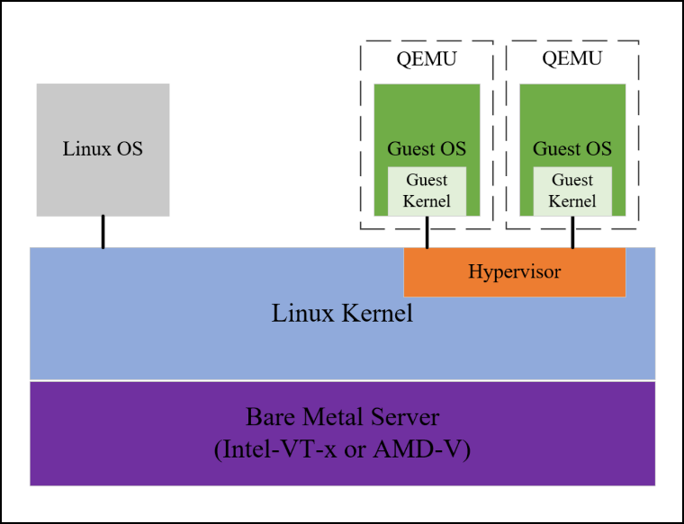
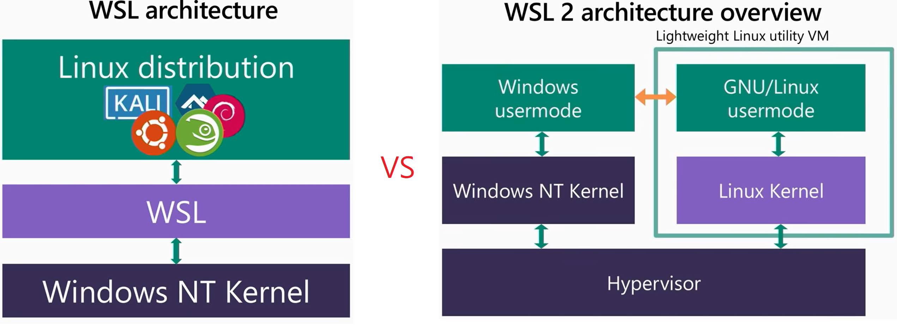

# Type 1 Hypervisors: KVM and Hyper-V

The previous chapter introduced the two hypervisor categories — Type 1 (bare-metal) and Type 2 (hosted) — along with the hardware extensions that make virtualization efficient. This chapter examines the major Type 1 hypervisors, with a detailed look at **KVM** (the dominant choice in Linux environments) and **Hyper-V** (Microsoft's counterpart for Windows), followed by an overview of other notable platforms like VMware ESXi, Proxmox VE, and Xen.

## Kernel-based Virtual Machine (KVM)

KVM is a Linux kernel module that has been included in mainline Linux since 2007. Once loaded, it turns the Linux kernel itself into a Type 1 hypervisor. KVM leverages hardware-assisted virtualization extensions — **Intel VT-x** / **AMD-V** for CPU virtualization and **Intel VT-d** / **AMD-Vi** for direct device passthrough — to run guest operating systems with near-native performance.



### Why KVM Is Classified as Type 1

This classification may seem counterintuitive since KVM operates within the Linux kernel, and Linux is an operating system. However, once the KVM module is loaded, the kernel itself functions as the hypervisor — managing and running isolated virtual machines with direct hardware access. The Linux kernel effectively *becomes* the bare-metal hypervisor rather than sitting underneath a separate one.

### User-Space Support with QEMU

KVM handles the core virtualization infrastructure — CPU scheduling, memory isolation, and hardware extension management (VT-x/AMD-V, VT-d/AMD-Vi). However, it does not emulate peripheral devices such as network interfaces, disk drives, or graphics adapters. For that, a user-space program like **QEMU** is used to:

- Define the VM's hardware configuration (CPU count, memory size, network adapters, etc.)
- Emulate the peripheral devices the guest OS expects to find

This QEMU/KVM pairing is covered in detail in [Chapter 11 — QEMU and KVM](11_qemu_and_kvm.md).

### KVM in the Market

KVM competes with VMware vSphere, which dominates enterprise data-center installations. KVM's key advantages include:

- **Open-source** — No vendor lock-in or licensing fees
- **Cost-effective** — Lower total cost of ownership for large deployments
- **Linux-native** — A natural fit for Linux-centric environments, compared to VMware vSphere or Hyper-V which are more common in Windows shops

## Hyper-V

Hyper-V is Microsoft's Type 1 hypervisor. It is built into Windows 10/11 Pro, Enterprise, and Education editions, as well as Windows Server, making it a common choice for enterprise environments, development, and testing.

### Key Features

| Feature | Description |
| --- | --- |
| Dynamic Memory | Adjusts guest RAM allocation at runtime based on demand |
| Checkpoints | Point-in-time snapshots for rollback (similar to QEMU snapshots) |
| Nested Virtualization | Run a hypervisor inside a VM (e.g., Hyper-V inside Hyper-V) |
| Virtual Networking | Built-in virtual switch with NAT, external, and internal modes |
| Linux Guest Support | Runs Ubuntu, Debian, CentOS, and other Linux distributions as guests |
| Live Migration | Move running VMs between hosts with zero downtime (Server editions) |

### Compatibility with Other Hypervisors

When Hyper-V is enabled, it takes control of the CPU's hardware virtualization extensions (Intel VT-x / AMD-V). This has a major practical consequence: **other hypervisors can no longer access the hardware directly**.

Software like VirtualBox and VMware Workstation are designed as Type 2 hypervisors that expect direct access to VT-x/AMD-V. With Hyper-V sitting underneath, they must either:

- **Run on top of Hyper-V** using compatibility modes (VirtualBox 7.x and VMware Workstation 15.5.5+ support this officially, though with potential performance degradation).
- **Disable Hyper-V entirely** (requires a reboot):

```powershell
bcdedit /set hypervisorlaunchtype off
```

To re-enable it later:

```powershell
bcdedit /set hypervisorlaunchtype auto
```

> **Tip:** If you plan to use VirtualBox or VMware as your primary hypervisor, disabling Hyper-V avoids these compatibility issues. If you need both, consider using separate boot configurations.

### Architecture: Root and Child Partitions

Hyper-V organizes its environment into **partitions**:

| Partition | Also Called | Role |
| --- | --- | --- |
| Root partition | Parent partition | Runs the host Windows OS, manages the hypervisor, and has direct hardware access |
| Child partition | Guest partition | An isolated VM created and managed by the root partition |

The root partition hosts the Hyper-V management services (the virtualization stack) and controls all VM-related resources — networking, storage, and device assignment. Child partitions communicate with hardware through virtualized interfaces provided by the root partition. Every Hyper-V system has exactly one root partition and zero or more child partitions.

### Windows Subsystem for Linux (WSL)

WSL lets you run a full Linux environment directly on Windows — including the shell, package managers, compilers, and system utilities — without dual-booting or running a traditional VM. It was introduced to give developers Linux capabilities within a Windows workflow.

#### WSL 1 vs. WSL 2

| Aspect | WSL 1 | WSL 2 |
| --- | --- | --- |
| Approach | Translates Linux syscalls into Windows syscalls | Runs a real Linux kernel in a lightweight VM |
| Syscall Compatibility | Partial — some Linux syscalls have no Windows equivalent | Full — 100% Linux kernel syscall support |
| File System Performance | Fast for Windows files (`/mnt/c/`) | Fast for Linux files; slower for Windows cross-filesystem access |
| Docker Support | Not supported | Fully supported |
| Memory Usage | Shared with Windows | Dedicated VM memory (dynamically managed) |
| Networking | Shares the host's network stack | Separate virtual NIC with NAT to the host |

WSL 2 uses Hyper-V's **lightweight utility VM** technology to run a Microsoft-compiled Linux kernel. Despite being a VM, it is deeply integrated with Windows — Linux and Windows processes can share files, and you can launch Linux commands from PowerShell and vice versa.

> **Note:** WSL 2's lightweight VM is available even on Windows Home edition through the **Virtual Machine Platform** feature, which does not require a full Hyper-V installation.

#### WSL 2 Architecture

The diagram below shows how WSL 1 and WSL 2 differ structurally:



The WSL 2 architecture consists of five key components:

| Component | Description |
| --- | --- |
| **Hypervisor** | The Hyper-V Type 1 layer that creates and manages the lightweight Linux VM |
| **Windows NT Kernel** | The core Windows kernel; interacts with the hypervisor and manages Windows services |
| **Linux Kernel** | A full open-source Linux kernel compiled by Microsoft; provides complete syscall compatibility |
| **Windows Usermode** | Windows shell, PowerShell, apps, and WSL integration features (file sharing, launching Linux apps) |
| **GNU/Linux Usermode** | The Linux user-space environment (bash, SSH, Python, GCC) provided by your chosen distribution |

The Windows and Linux sides communicate through the hypervisor. This allows features like accessing Linux files from Windows Explorer (`\\wsl$\`) and running Windows executables from the Linux shell.

## Other Notable Type 1 Hypervisors

Several other Type 1 hypervisors are widely used in production:

| Hypervisor | Vendor | Key Characteristics |
| --- | --- | --- |
| **Xen** | Linux Foundation | One of the earliest open-source hypervisors (2003). Uses a microkernel design where a privileged **dom0** (Domain 0) guest manages hardware on behalf of unprivileged **domU** guests. Powers Amazon EC2's older instance types. |
| **VMware ESXi** | Broadcom (VMware) | The dominant enterprise hypervisor. ESXi is a purpose-built bare-metal OS with its own kernel. Managed through **vCenter Server** and the **vSphere** suite. Commercial licensing. |
| **Oracle VM (OVM)** | Oracle | Based on Xen, optimized for Oracle workloads (databases, middleware). Managed through Oracle VM Manager. |
| **Proxmox VE** | Proxmox Server Solutions | An open-source platform built on **Debian Linux + KVM + LXC**. Provides a web-based management UI for VMs and containers, clustering, storage (ZFS, Ceph), and backup — all without licensing fees. Popular in homelabs and small-to-medium enterprises. |

### Proxmox VE

Proxmox VE deserves special mention because it is not a separate hypervisor — it is a **management platform** built on top of KVM (for VMs) and LXC (for containers). When you create a VM in Proxmox, KVM is the underlying hypervisor doing the actual virtualization. Proxmox adds:

- **Web UI** — Browser-based management for VMs, containers, storage, and networking
- **Clustering** — Join multiple Proxmox hosts into a cluster with live migration
- **Integrated backup** — Scheduled VM/container backups with Proxmox Backup Server
- **Storage backends** — Local (ZFS, LVM), shared (NFS, Ceph, iSCSI), and more

This relationship is similar to how **libvirt** (covered in [Chapter 19](19_libvirt.md)) provides a management layer on top of KVM — Proxmox simply goes further with a full web interface and clustering support.

---

[← Previous: Hardware Virtualization](02_hardware_virtualization.md) | [Next: QEMU →](04_qemu.md)
