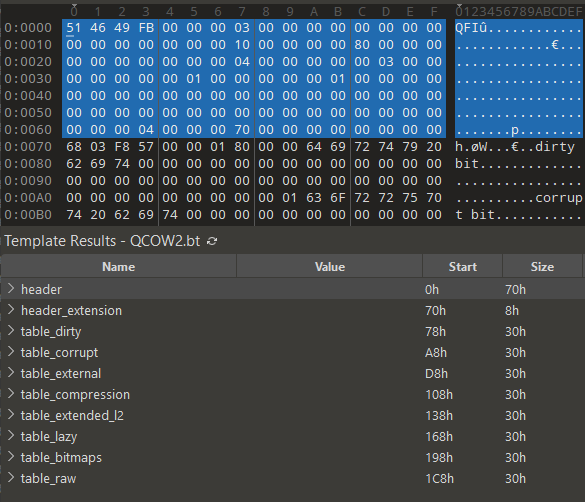
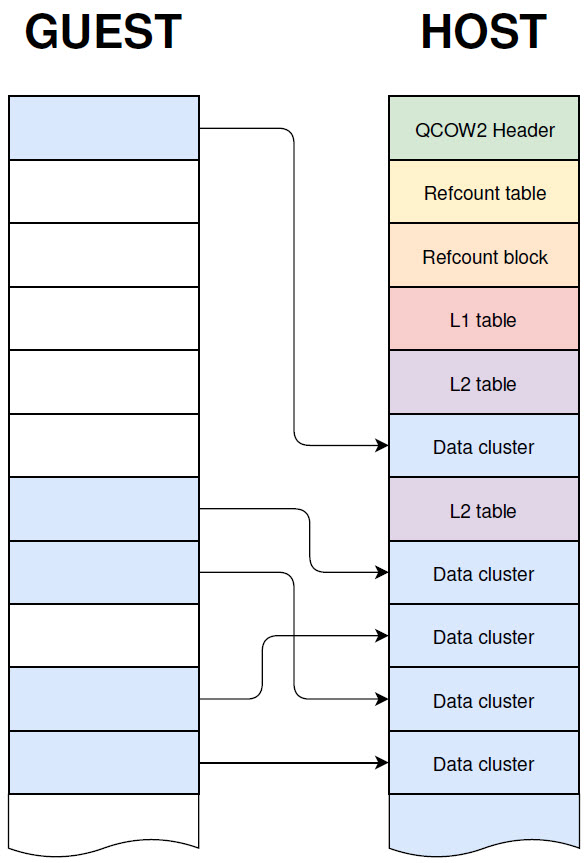
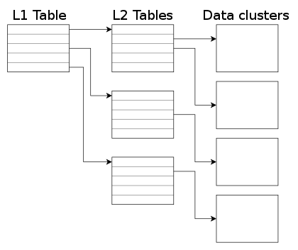
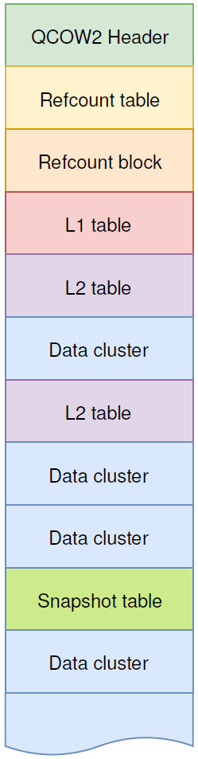

# QCOW2

QCOW2 (QEMU Copy-On-Write version 2) is the primary disk image format used by QEMU and KVM. It replaced the original QCOW format and has become the standard for Linux-based virtualization due to its rich feature set:

- **Sparse allocation** — Disk space is consumed only as data is written, not reserved upfront
- **Copy-on-write (COW)** — Enables snapshots and backing files without duplicating data
- **Snapshots** — Multiple point-in-time states of the virtual disk can be saved and restored
- **Compression** — Clusters can be individually compressed (zlib or zstd)
- **Encryption** — Supports AES and LUKS-based full-disk encryption
- **Backing files** — A new image can reference a read-only base image, storing only the differences

## QCOW2 Versions

The QCOW2 header contains a `version` field that can be **2** or **3**:

| Version | Introduced | Key Changes |
|---------|------------|-------------|
| **Version 2** | QEMU 0.6.0 (2004) | Original QCOW2 format with snapshots, AES encryption, zlib compression, and sparse allocation |
| **Version 3** | QEMU 1.1 (2012) | Added feature bitmasks (incompatible, compatible, autoclear), configurable refcount width, lazy refcounts, and extended L2 entries for subcluster allocation |

Version 3 (identified by `compat: 1.1` in `qemu-img info` output) is the default in modern QEMU. New capabilities are added through **feature bits** within version 3 rather than by incrementing the version number.

## Prerequisites

Install the required tools to work with QCOW2 images:

```bash
sudo apt update
sudo apt install qemu-utils -y
```

## Creating a QCOW2 Disk Image

Create a new QCOW2 disk image with a virtual size of 2 GB:

```bash
qemu-img create -f qcow2 mydisk.qcow2 2G
```

Verify the file type:

```bash
file mydisk.qcow2
```

```
mydisk.qcow2: QEMU QCOW2 Image (v3), 2147483648 bytes
```

Inspect the image details:

```bash
qemu-img info mydisk.qcow2
```

```
image: mydisk.qcow2
file format: qcow2
virtual size: 2 GiB (2147483648 bytes)
disk size: 196 KiB
cluster_size: 65536
Format specific information:
    compat: 1.1
    compression type: zlib
    lazy refcounts: false
    refcount bits: 16
    corrupt: false
    extended l2: false
```

### Virtual Size vs. Disk Size

The **virtual size** (2 GiB) is the total storage capacity exposed to the guest VM. The **disk size** (196 KiB) is the actual space consumed on the host filesystem. This gap exists because QCOW2 is a sparse format — it allocates storage dynamically as the guest writes data, rather than reserving the full virtual size upfront. The image starts small and grows as needed.

## Inspecting a QCOW2 File with a Hex Editor

Since a QCOW2 image is a binary file with a well-defined structure, it can be opened in any hex editor to examine the raw bytes — the magic number, version field, cluster bits, and every other header field are visible at their documented offsets.

Some hex editors go a step further with **binary templates** (also called grammars or format definitions). For example, [010 Editor](https://www.sweetscape.com/010editor/) can detect that a file is QCOW2 and automatically apply a template that parses the binary data into labeled, structured fields. Instead of reading raw hex values, you see the header fields, L1/L2 table entries, and refcount structures presented in a readable, navigable form.



The following sections explain the concepts needed to interpret these structures — starting with clusters, then the header fields, and finally the mapping and management mechanisms.

## Clusters

A cluster is the fundamental unit of storage allocation in QCOW2. All data and metadata in the image is organized into fixed-size clusters. Before examining the header and table structures, it is essential to understand how clusters work.

### Host Clusters vs. Guest Clusters

**Guest clusters** are the filesystem blocks managed by the guest operating system (e.g., ext4 or NTFS block groups). **Host clusters** are the allocation units within the QCOW2 file itself, managed by QEMU on the host.

These two layers are independent — the guest's storage layout does not map directly to the QCOW2 host layout. Fragmentation, allocation behavior, and performance characteristics can differ between the two layers.

### Host Cluster Size

The host cluster size defines the smallest unit of allocation within the QCOW2 image. The default is **64 KiB** (65,536 bytes), but it is configurable at image creation:

```bash
qemu-img create -f qcow2 -o cluster_size=128K disk.qcow2 10G
```

The cluster size is always a power of two, calculated as `1 << cluster_bits` where `cluster_bits` is stored in the QCOW2 header. The supported range is:

- **Minimum:** 512 bytes (`cluster_bits` = 9)
- **Maximum:** 2 MB (`cluster_bits` = 21)

**Trade-offs:**

- **Larger clusters** reduce metadata overhead and improve sequential I/O throughput, but waste space when the guest writes small amounts of data (internal fragmentation).
- **Smaller clusters** use space more efficiently but increase the number of metadata entries and L2 table lookups.

If the guest's filesystem block size differs significantly from the QCOW2 cluster size, performance may be affected. A guest block size much smaller than the host cluster size can lead to write amplification; a guest block size larger than the host cluster can cause single writes to span multiple clusters.

## QCOW2 Disk Structure

A QCOW2 file grows dynamically and only allocates space as needed. Apart from the header, there is no fixed location for data or metadata clusters — they can appear mixed anywhere in the file.



Internally, a QCOW2 image is organized around several key components:

- **Header** — Fixed metadata at the start of the file (magic number, version, virtual size, cluster size, and pointers to the tables below)

- **L1 / L2 tables** — A two-level mapping structure that translates guest cluster addresses to host cluster offsets. There is one L1 table per image (always kept in memory) and potentially many L2 tables. Covered in the [Cluster Mapping](#cluster-mapping-l1l2-tables) section.

- **Refcount table / blocks** — A two-level structure tracking how many times each host cluster is referenced. Essential for snapshots and space reclamation. Covered in the [Reference Counts](#reference-counts) section.

- **Snapshot table** — Metadata for saved point-in-time disk states. Covered in the [Snapshots](#snapshots) section.

- **Data clusters** — The actual guest data.

The full QCOW2 specification is maintained in the QEMU source tree: [qcow2.rst](https://github.com/qemu/qemu/blob/master/docs/interop/qcow2.rst)

## QCOW2 Header

Now that clusters are understood, we can examine the header — the first structure in every QCOW2 file. It begins at byte offset 0 and contains the core metadata, including pointers to all other structures in the image:

| Offset | Size (bytes) | Field Name            | Description                                                                         |
|--------|--------------|-----------------------|-------------------------------------------------------------------------------------|
| 0x00   | 4            | Magic                 | Always `514649FB` (`QFI\xFB` in ASCII)                                              |
| 0x04   | 4            | Version               | Format version (`2` or `3`)                                                         |
| 0x08   | 8            | Backing file offset   | Offset of the backing file name in the image (0 if none)                            |
| 0x10   | 4            | Backing file size     | Length of the backing file name (max 1023 bytes)                                    |
| 0x14   | 4            | Cluster bits          | Number of bits for addressing within a cluster (`1 << cluster_bits` = cluster size) |
| 0x18   | 8            | Size                  | Virtual disk size in bytes                                                          |
| 0x20   | 4            | Crypt method          | Encryption method (`0` = none, `1` = AES, `2` = LUKS)                              |
| 0x24   | 4            | L1 table size         | Number of entries in the active L1 table                                            |
| 0x28   | 8            | L1 table offset       | Offset of the active L1 table (must be cluster-aligned)                             |
| 0x30   | 8            | Refcount table offset | Offset of the refcount table (must be cluster-aligned)                              |
| 0x38   | 4            | Refcount table clusters | Number of clusters occupied by the refcount table                                 |
| 0x3C   | 4            | Number of snapshots   | Number of snapshots in the image                                                    |
| 0x40   | 8            | Snapshots offset      | Offset of the snapshot table (must be cluster-aligned)                              |

### Additional Fields (Version 3+)

Version 3 extends the header to at least **104 bytes** with these fields:

| Offset | Size (bytes) | Field Name            | Description                                                                     |
|--------|--------------|-----------------------|---------------------------------------------------------------------------------|
| 0x48   | 8            | Incompatible features | Bitmask of required features (image must not be opened if unknown bits are set) |
| 0x50   | 8            | Compatible features   | Bitmask of optional features (can be safely ignored)                            |
| 0x58   | 8            | Autoclear features    | Bitmask of features automatically cleared before writing                        |
| 0x60   | 4            | Refcount order        | Refcount entry width: `1 << refcount_order` bits per entry (max 6 → 64 bits)   |
| 0x64   | 4            | Header length         | Total header length (must be a multiple of 8)                                   |

**Incompatible Features (bits 0–63 at offset 0x48):**

| Bit  | Feature                                                                                  |
|------|------------------------------------------------------------------------------------------|
| 0    | **Dirty bit** — Refcounts may be inconsistent; requires L1/L2 scan before use            |
| 1    | **Corrupt bit** — Data structures may be corrupt; image should not be written to          |
| 2    | **External data file** — Guest data stored in a separate file; no compression or snapshots |
| 3    | **Compression type** — Uses a non-default compression method (e.g., zstd)                |
| 4    | **Extended L2 entries** — Enables subcluster-based allocation                            |
| 5–63 | Reserved                                                                                 |

**Compatible Features (bits 0–63 at offset 0x50):**

| Bit  | Feature                                                  |
|------|----------------------------------------------------------|
| 0    | **Lazy refcounts** — Allows deferred refcount updates    |
| 1–63 | Reserved                                                 |

**Autoclear Features (bits 0–63 at offset 0x58):**

| Bit  | Feature                                                                  |
|------|--------------------------------------------------------------------------|
| 0    | **Bitmaps extension** — Ensures bitmap data consistency                  |
| 1    | **Raw external data** — External data file can be read as a raw image    |
| 2–63 | Reserved                                                                 |

### Optional Fields

For version 3, optional fields may appear beyond byte 104:

| Offset | Size (bytes) | Field Name       | Description                                    |
|--------|--------------|------------------|------------------------------------------------|
| 0x68   | 4            | Compression type | Compression method (`0` = deflate, `1` = zstd) |
| 0x6C   | 4–8          | Padding          | Reserved for future extensions                 |

## Header Extensions

After the main header, optional **header extensions** provide additional metadata. Each extension follows this structure:

| Offset | Size (bytes) | Field Name     | Description                                    |
|--------|--------------|----------------|------------------------------------------------|
| 0x00   | 4            | Extension type | Type identifier (see below)                    |
| 0x04   | 4            | Data length    | Length of the extension data                   |
| 0x08   | variable     | Extension data | Data specific to the extension type            |
| —      | variable     | Padding        | Padding to align to the next multiple of 8     |

Known extension types:

| Extension Type             | Value (Hex)  | Description                                  |
|----------------------------|--------------|----------------------------------------------|
| End of extensions          | `0x00000000` | Marks the end of the header extension area   |
| Backing file format name   | `0xe2792aca` | Format name of the backing file              |
| Feature name table         | `0x6803f857` | Human-readable list of enabled features      |
| Bitmaps extension          | `0x23852875` | Additional bitmap metadata                   |
| Full disk encryption header| `0x0537be77` | Pointer to a full disk encryption header     |
| External data file name    | `0x44415441` | Name of an external data file                |

Each extension type should appear at most once per image.

## Cluster Mapping (L1/L2 Tables)

QCOW2 uses a two-level table structure to translate **guest cluster indices** (virtual disk addresses) into **host cluster offsets** (physical locations in the QCOW2 file).



### L1 Table

The L1 table is specified by two header fields: `L1 table offset` and `L1 table size` (number of entries). The table may span multiple clusters but must be contiguous in the file. Each entry is 8 bytes and points to an L2 table:

| Bits  | Description                                                    |
|-------|----------------------------------------------------------------|
| 0–8   | Reserved (0)                                                   |
| 9–55  | Offset of L2 table (must be cluster-aligned, 0 if unallocated) |
| 56–62 | Reserved (0)                                                   |
| 63    | 1 if refcount is exactly one, 0 if unused or needs COW         |

**Example:** An L1 table with 4 entries in hex:

```
80 00 00 00 00 04 00 00   80 00 00 00 00 9B 00 00
80 00 00 00 00 9E 00 00   80 00 00 00 00 99 00 00
```

Breaking down the first entry (`80 00 00 00 00 04 00 00`):

- `0x80` → Bit 63 is set (refcount = 1, cluster is in use)
- Bits 9–55 → L2 table offset = `0x00040000`

### L2 Table

Each L2 table is exactly **one cluster** in size. With a 64 KiB cluster size, that gives:

```
65,536 bytes / 8 bytes per entry = 8,192 entries per L2 table
```

Each L2 entry is 8 bytes:

| Bits  | Description                                                         |
|-------|---------------------------------------------------------------------|
| 0–61  | Cluster descriptor (see below)                                      |
| 62    | 0 = standard cluster, 1 = compressed cluster                       |
| 63    | 1 if refcount is exactly one, 0 if unused, compressed, or needs COW |

**Standard cluster descriptor:**

| Bits  | Description                                              |
|-------|----------------------------------------------------------|
| 0     | 1 = reads as all zeros (preallocated but unused)         |
| 1–8   | Reserved (0)                                             |
| 9–55  | Host cluster offset (cluster-aligned, 0 if unallocated)  |
| 56–61 | Reserved (0)                                             |

**Compressed cluster descriptor:**

| Bits    | Description                                     |
|---------|-------------------------------------------------|
| 0–(x-1) | Host cluster offset (not necessarily aligned)   |
| x–61    | Additional 512-byte sectors for compressed data |

## Locating a Cluster

To read or write data, QEMU must translate a guest cluster index (GCI) into a host file offset. Here is a step-by-step example using the default 64 KiB cluster size (8,192 entries per L2 table).

**Goal:** Find the host offset for guest cluster index **20,000**.

**Step 1 — Determine the L1 index:**

Each L2 table covers 8,192 clusters, so:

```
L1 index = GCI / 8192 = 20,000 / 8,192 = 2  (integer division)
```

This means the cluster is managed by the **third** L2 table (index 2, zero-based).

**Step 2 — Look up the L2 table pointer:**

Read `L1[2]` to get the host offset of the third L2 table.

**Step 3 — Determine the L2 entry index:**

```
L2 index = GCI mod 8192 = 20,000 mod 8,192 = 3,616
```

**Step 4 — Read the L2 entry:**

Read `L2[3616]` from the third L2 table. This entry contains the host cluster offset.

**Step 5 — Compute the host offset:**

If `L2[3616] = 0x12345000`, the guest data for cluster 20,000 is stored starting at offset `0x12345000` in the QCOW2 file.

## Reference Counts

Each host cluster in the QCOW2 image has an associated **reference count** (refcount) that tracks how many times the cluster is referenced:

| Refcount | Meaning |
|----------|---------|
| **0**    | Free — available for allocation |
| **1**    | In use by a single image state |
| **≥ 2**  | Shared — referenced by multiple snapshots; requires copy-on-write (COW) before modification |

Reference counts are essential for snapshots, space reclamation, and corruption detection. When a snapshot is deleted, the refcount of each cluster it referenced is decremented. If a refcount reaches 0, the cluster is freed for reuse.

### Refcount Table and Blocks

The refcount system uses a two-level structure similar to L1/L2 tables:

- **Refcount table** — A top-level index where each entry points to a refcount block. Its location and size are specified by the header fields `Refcount table offset` and `Refcount table clusters`. The table grows dynamically as the image expands.
- **Refcount block** — Stores the actual refcount values for a range of clusters. Each cluster in the image has one entry in a refcount block.

### Refcount Lookup

To find the refcount of a cluster at a given `offset` in the image:

**Step 1 — Calculate the number of entries per refcount block:**

```
refcount_block_entries = (cluster_size × 8) / refcount_bits
```

**Step 2 — Compute the table and block indices:**

```
refcount_table_index = (offset / cluster_size) / refcount_block_entries
refcount_block_index = (offset / cluster_size) % refcount_block_entries
```

**Step 3 — Retrieve the refcount:**

```
refcount_block = load_cluster(refcount_table[refcount_table_index])
refcount = refcount_block[refcount_block_index]
```

## L2 Cache

Every read or write to the virtual disk requires an L2 table lookup to find the host cluster offset. Since loading an L2 table from disk for every I/O operation would be expensive, QEMU maintains an **L2 cache** in memory.

The cache size has a significant impact on performance. The following benchmark shows random read IOPS on a fully populated 20 GB image with different L2 cache sizes:

| L2 Cache Size | Average IOPS |
|---------------|--------------|
| 1 MB          | 5,100        |
| 1.5 MB        | 7,300        |
| 2 MB          | 12,700       |
| 2.5 MB        | 63,600       |

The dramatic jump at 2.5 MB indicates the entire L2 table set fits in cache at that size, eliminating disk reads for metadata lookups.

## Snapshots

A snapshot preserves the state of a virtual disk at a specific point in time, allowing users to revert to that state later. QCOW2 implements snapshots efficiently using **copy-on-write** (COW): when a snapshot is taken, the current data is not duplicated. Instead, any subsequent writes go to newly allocated clusters while the original clusters remain untouched. The reference count system ensures unmodified clusters are shared between the active image and its snapshots.

### Snapshot Table

The snapshot table stores metadata for all snapshots. Its location and count are specified by the header fields `Snapshots offset` and `Number of snapshots`.



Each entry in the snapshot table contains:

| Byte Range | Description                                                                             |
|------------|-----------------------------------------------------------------------------------------|
| 0–7        | Offset of the L1 table for this snapshot (cluster-aligned)                              |
| 8–11       | Number of entries in the snapshot's L1 table                                            |
| 12–13      | Length of the unique ID string                                                          |
| 14–15      | Length of the snapshot name                                                             |
| 16–19      | Timestamp — seconds since epoch                                                         |
| 20–23      | Timestamp — nanosecond component                                                        |
| 24–31      | Guest uptime at snapshot creation (nanoseconds)                                         |
| 32–35      | Size of saved VM state in bytes (0 if no state saved)                                   |
| 36–39      | Size of extra data in this entry (for future extensions)                                |
| 40–47      | (Optional) VM state size — overrides bytes 32–35 if present                             |
| 48–55      | (Optional) Virtual disk size at snapshot time                                           |
| 56–63      | (Optional) icount value for record/replay (-1 if disabled)                              |
| Variable   | Unique ID string (not null-terminated)                                                  |
| Variable   | Snapshot name (not null-terminated)                                                     |
| Variable   | Padding to align to the next multiple of 8                                              |

### Working with Snapshots

Create a snapshot:

```bash
qemu-img snapshot -c snap1 mydisk.qcow2
```

List all snapshots:

```bash
qemu-img snapshot -l mydisk.qcow2
```

Restore to a previous snapshot:

```bash
qemu-img snapshot -a snap1 mydisk.qcow2
```

## Backing Files and Overlays

A **backing file** is a read-only base image that a new QCOW2 image references. The new image (called the **overlay** or **delta image**) only stores the differences — any data that has not been modified is read from the backing file.

This is useful for:

- **Template-based provisioning** — Creating many VMs from a single base image without duplicating it
- **Testing** — Making experimental changes that can be discarded by simply deleting the overlay
- **Layered images** — Backing files can be chained, forming a hierarchy of incremental changes

The backing file relationship is stored in the QCOW2 header via the `Backing file offset` and `Backing file size` fields.

Create an overlay that references an existing base image:

```bash
qemu-img create -f qcow2 -b base.qcow2 -F qcow2 overlay.qcow2
```

The overlay starts nearly empty. Reads for unmodified data are forwarded to `base.qcow2`; writes go only to `overlay.qcow2`.

---

[← Previous: Virtual Disk Images](05_virtual_disk_image.md) | [Next: Minimal Root Filesystem →](07_minimal_root_fs.md)
