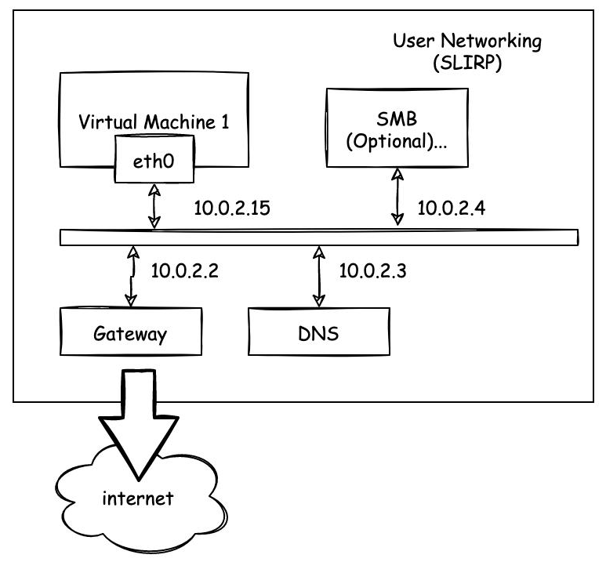
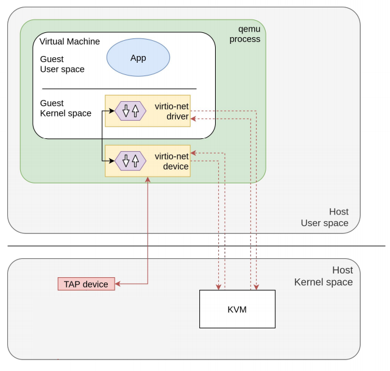
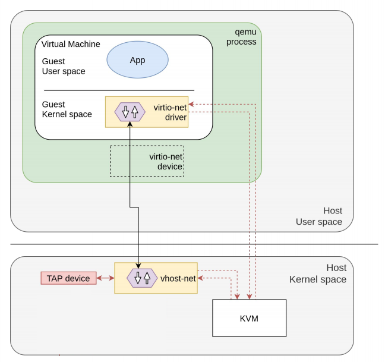
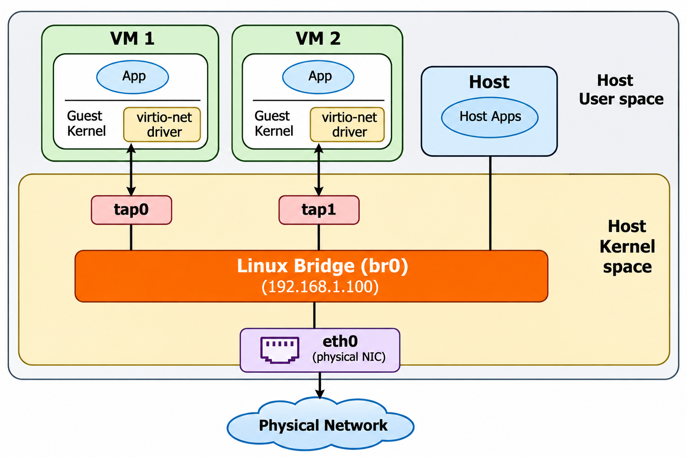

# QEMU Networking Modes

QEMU networking is split into two layers: the **front-end** (the virtual NIC visible to the guest, covered in [Chapter 16](16_virtual_network_adapters.md)) and the **back-end** (how that NIC connects to the host's network). This chapter covers the back-end — the networking modes that determine what the VM can reach. All examples use `virtio-net-pci` as the front-end for best performance.

The back-end is configured with the `-netdev` option, paired with a `-device` for the front-end:

```bash
qemu-system-x86_64 \
    -netdev user,id=net0 \
    -device virtio-net-pci,netdev=net0
```

The `-nic` shorthand combines both in one flag:

```bash
qemu-system-x86_64 -nic user,model=virtio-net-pci
```

To disable networking entirely, use `-nic none`.

## Comparison

| Mode           | VM → Internet | Internet → VM | VM → Host | Host → VM | VM ↔ VM          |
|----------------|:-------------:|:-------------:|:---------:|:---------:|:----------------:|
| User (SLiRP)   | ✓             | Port fwd      | ✓         | Port fwd  | ✗                 |
| TAP            | ✗             | ✗             | ✓         | ✓         | ✗                 |
| TAP + Bridge   | ✓             | ✓             | ✓         | ✓         | ✓                 |
| Socket         | ✗             | ✗             | ✗         | ✗         | ✓ (same group)   |
| VDE            | Depends       | Depends       | Depends   | Depends   | ✓                 |

## User-Mode Networking (SLiRP)

User-mode networking is the default. QEMU implements a full TCP/IP stack in user space using the SLiRP library — no root privileges and no host network configuration are needed. This is the simplest way to give a VM internet access.

```bash
qemu-system-x86_64 -hda disk.qcow2 \
    -netdev user,id=net0 \
    -device virtio-net-pci,netdev=net0
```



QEMU's built-in stack provides DHCP, DNS forwarding, and optional TFTP and SMB services. The VM is placed on a private virtual network:

| Setting            | Default Value |
|--------------------|---------------|
| Network            | `10.0.2.0/24` |
| VM IP (via DHCP)   | `10.0.2.15`   |
| Gateway / Host     | `10.0.2.2`    |
| DNS server         | `10.0.2.3`    |
| SMB server         | `10.0.2.4`    |

The VM can access the internet through NAT, and can reach host services via `10.0.2.2`. Inbound connections from the host are not possible by default — use **port forwarding** to expose guest services:

```bash
# Forward host port 2222 to guest port 22 (SSH)
qemu-system-x86_64 -hda disk.qcow2 \
    -netdev user,id=net0,hostfwd=tcp::2222-:22 \
    -device virtio-net-pci,netdev=net0
```

Multiple forwarding rules can be specified by repeating `hostfwd`:

```bash
-netdev user,id=net0,hostfwd=tcp::2222-:22,hostfwd=tcp::8080-:80 \
-device virtio-net-pci,netdev=net0
```

Then connect from the host:

```bash
ssh -p 2222 user@localhost
```

**Limitations:**

- Performance is lower than TAP (all packets processed in user space)
- ICMP (ping) does not work by default
- Each VM runs on its own isolated network — VMs cannot communicate with each other
- Not suitable for high-throughput or latency-sensitive workloads

## TAP Networking

TAP networking creates a virtual Ethernet device (a TAP interface) on the host. The VM's traffic appears as real Ethernet frames on this interface, enabling full Layer 2 connectivity. This is the recommended mode for production and lab environments.

```bash
# Create a TAP interface
sudo ip tuntap add dev tap0 mode tap user $(whoami)
sudo ip link set tap0 up

# Start the VM
qemu-system-x86_64 -hda disk.qcow2 \
    -netdev tap,id=net0,ifname=tap0,script=no,downscript=no \
    -device virtio-net-pci,netdev=net0
```

By default, QEMU runs `/etc/qemu-ifup` and `/etc/qemu-ifdown` scripts when a TAP interface is created and destroyed. Passing `script=no,downscript=no` disables this, giving you full manual control.

In the standard configuration, packets flow from the guest's virtio-net driver through the virtio-net device in the QEMU process (user space), then into the host kernel's TAP device and Linux bridge:



For high-throughput workloads, the **vhost-net** kernel module can bypass QEMU's user-space processing entirely. Packets move directly between the guest and the host kernel's TAP device, significantly reducing CPU overhead and latency:



To enable vhost-net, add `vhost=on` to the netdev option (e.g., `-netdev tap,id=net0,ifname=tap0,vhost=on,...`).

## TAP + Bridge

A TAP interface alone only provides a point-to-point link between the VM and the host. To give the VM access to the physical LAN (equivalent to [VirtualBox's Bridged mode](18_networking_modes_virtualBox.md#bridged-adapter)), attach the TAP to a Linux bridge alongside the host's physical NIC:

```bash
# Create a bridge and attach the host NIC and TAP
sudo ip link add br0 type bridge
sudo ip link set eth0 master br0
sudo ip link set tap0 master br0
sudo ip link set br0 up

# Move the host's IP to the bridge
sudo ip addr del 192.168.1.100/24 dev eth0
sudo ip addr add 192.168.1.100/24 dev br0
sudo ip route add default via 192.168.1.1 dev br0
```

The VM now obtains its own IP from the network's DHCP server and appears as a separate device on the LAN.

To connect **multiple VMs**, create a separate TAP interface for each and attach them all to the same bridge. The VMs can then communicate with each other, the host, and external networks.



**Requires:** Root privileges (or `CAP_NET_ADMIN`) to create TAP interfaces and bridges.

### Bridge Helper

QEMU provides `qemu-bridge-helper`, a setuid helper that automates the TAP + bridge setup. Instead of creating TAP interfaces manually, you specify which bridge to join:

```bash
qemu-system-x86_64 -hda disk.qcow2 \
    -netdev bridge,id=net0,br=br0 \
    -device virtio-net-pci,netdev=net0
```

The helper must be authorized to use the bridge. Add the bridge name to `/etc/qemu/bridge.conf`:

```
allow br0
```

Then grant the helper the required capabilities:

```bash
sudo setcap cap_net_admin,cap_net_raw+ep /usr/lib/qemu/qemu-bridge-helper
```

Because the helper runs with elevated privileges, no additional root access is needed to start the VM. The bridge itself must already exist on the host.

## Socket Networking

Socket networking connects VMs directly to each other using UDP or TCP sockets — without any host network configuration. This is useful for creating isolated VM-to-VM networks (similar to [VirtualBox's Internal Network](18_networking_modes_virtualBox.md#internal-network)).

**Multicast UDP** (simplest for multiple VMs):

```bash
# VM 1
qemu-system-x86_64 -hda vm1.qcow2 \
    -netdev socket,id=net0,mcast=230.0.0.1:1234 \
    -device virtio-net-pci,netdev=net0

# VM 2
qemu-system-x86_64 -hda vm2.qcow2 \
    -netdev socket,id=net0,mcast=230.0.0.1:1234 \
    -device virtio-net-pci,netdev=net0
```

All VMs using the same multicast address and port form a virtual network segment. IP addresses must be assigned manually inside each guest (there is no built-in DHCP).

**TCP** (point-to-point — one VM listens, the other connects):

```bash
# VM 1 (listener)
qemu-system-x86_64 -hda vm1.qcow2 \
    -netdev socket,id=net0,listen=:1234 \
    -device virtio-net-pci,netdev=net0

# VM 2 (connector)
qemu-system-x86_64 -hda vm2.qcow2 \
    -netdev socket,id=net0,connect=127.0.0.1:1234 \
    -device virtio-net-pci,netdev=net0
```

Socket networking provides no internet access — it is purely for VM-to-VM communication.

## VDE Networking

VDE (Virtual Distributed Ethernet) connects VMs to a software-based virtual switch (`vde_switch`). Multiple VMs — and optionally the host — can all connect to the same switch:

```bash
# Start a VDE switch
vde_switch -s /tmp/vde.ctl -daemon

# Start a VM connected to the switch
qemu-system-x86_64 -hda disk.qcow2 \
    -netdev vde,id=net0,sock=/tmp/vde.ctl \
    -device virtio-net-pci,netdev=net0
```

VDE requires the `vde2` package. Connectivity depends on how the switch is configured — it can be isolated or bridged to a physical interface for full LAN access.

---

[← Previous: Virtual Network Adapters](16_virtual_network_adapters.md) | [Next: VirtualBox Networking Modes →](18_networking_modes_virtualBox.md)
