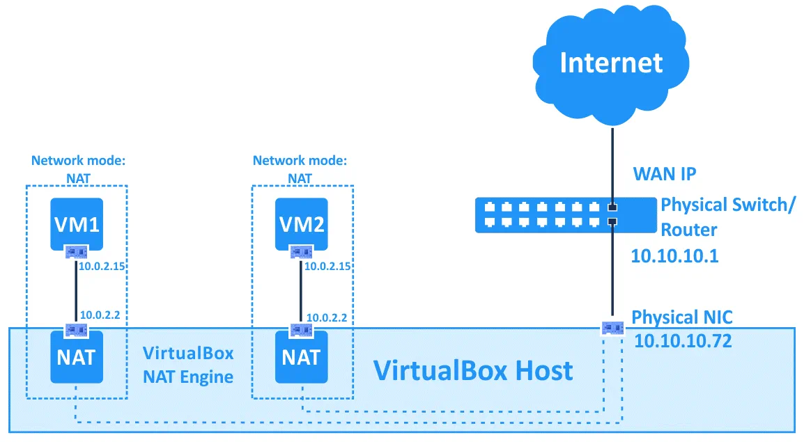
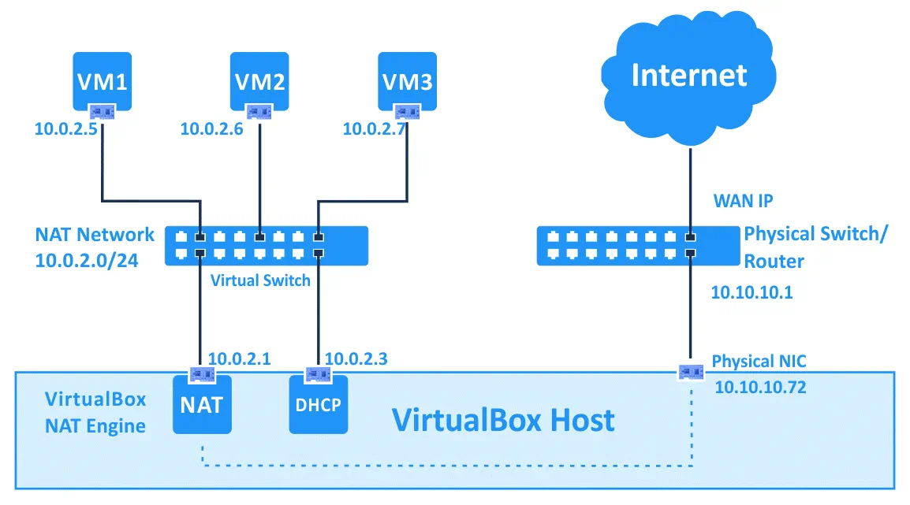
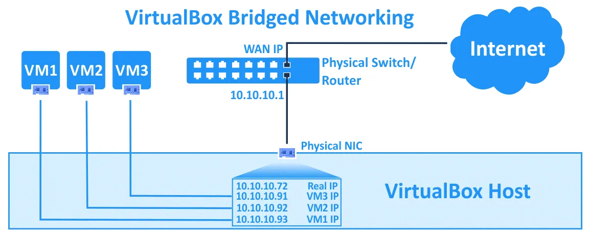
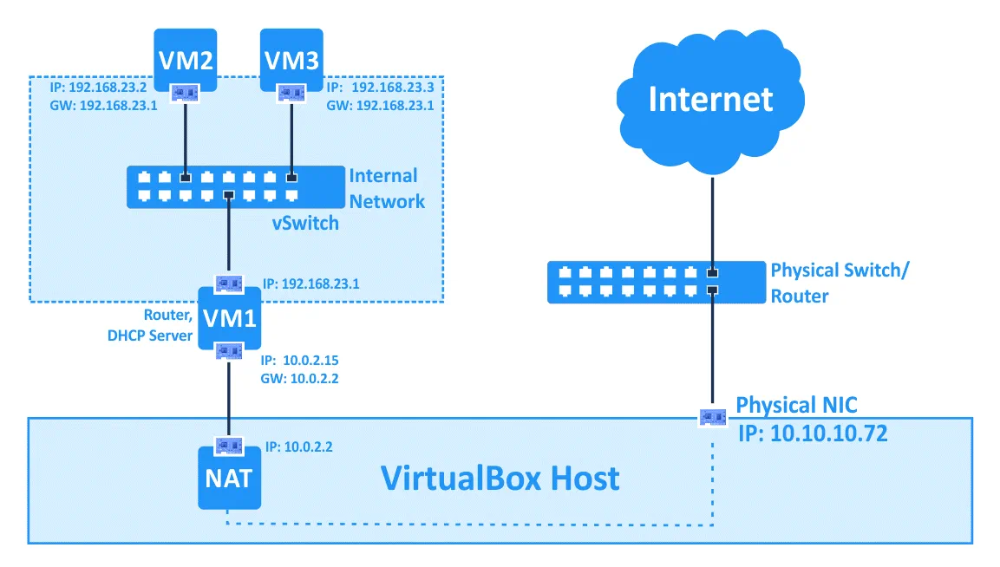
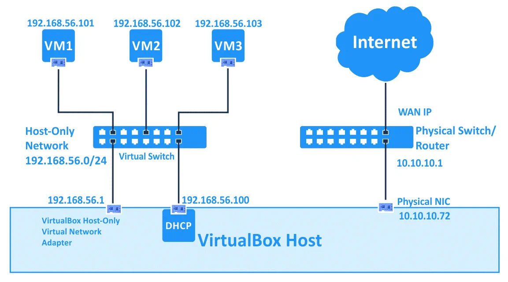

# VirtualBox Networking Modes

The [previous chapter](17_networking_modes_qemu.md) covered QEMU's networking modes, where you build connectivity from low-level pieces (TAP interfaces, bridges, socket backends). VirtualBox takes a different approach — it provides pre-packaged networking modes that you select from a drop-down menu, with no host-side configuration required for most use cases.

Each adapter's mode is selected from the **Attached to** drop-down menu.

## Comparison

The following table summarizes the connectivity each mode provides:

| Mode              | VM → Internet | Internet → VM | VM → Host | Host → VM | VM ↔ VM          |
|-------------------|:---:|:---:|:---:|:---:|:---:|
| Not Attached      | ✗             | ✗             | ✗         | ✗         | ✗                 |
| NAT               | ✓             | Port fwd      | ✓         | Port fwd  | ✗                 |
| NAT Network       | ✓             | Port fwd      | ✓         | Port fwd  | ✓ (same network) |
| Bridged Adapter   | ✓             | ✓             | ✓         | ✓         | ✓                 |
| Internal Network  | ✗             | ✗             | ✗         | ✗         | ✓ (same network) |
| Host-Only Adapter | ✗             | ✗             | ✓         | ✓         | ✓                 |

## Not Attached

The virtual NIC is present in the VM but has no network connection — equivalent to unplugging an Ethernet cable from a physical NIC. This is useful for testing how a guest handles link loss, or verifying that a DHCP client recovers correctly after disconnection.

> **Tip:** You can achieve the same effect in any networking mode by unchecking the **Cable Connected** checkbox.

## NAT

NAT is the default networking mode. The VM shares the host's IP address and uses Network Address Translation to reach external networks. This is the simplest option for VMs that only need outbound internet access (browsing, updates, downloading packages).

VirtualBox includes a built-in DHCP server and NAT engine for each VM. The NAT device sits between the VM's virtual NIC and the host's physical adapter, translating network packets and masking the VM's IP address behind the host's.

Default addresses for NAT mode:

| Setting         | Value           |
|-----------------|-----------------|
| VM IP address   | `10.0.2.15`     |
| Subnet mask     | `255.255.255.0` |
| Default gateway | `10.0.2.2`      |

Each VM in NAT mode is placed in its own isolated virtual network. Although multiple VMs receive the same `10.0.2.15` address, they cannot communicate with each other — each operates in a separate private network.

Outbound connections work by default. Inbound connections from the external network are blocked unless you configure **port forwarding** rules. The NAT network addresses cannot be changed through the GUI; advanced users can modify them via `VBoxManage`.

## NAT Network

NAT Network is similar to NAT but places multiple VMs on a shared private network, so they can communicate with each other while still accessing the internet through the host.

NAT networks are managed from **File → Tools → Network Manager → NAT Networks** tab. You can create multiple NAT networks, each with a unique name and address range.

| Setting     | Default Value  | Template  |
|-------------|----------------|-----------|
| Network name| `NatNetwork`   | —         |
| IPv4 prefix | `10.0.2.0/24`  | —         |
| Gateway     | `10.0.2.1`     | `x.x.x.1`|
| DHCP server | `10.0.2.3`     | `x.x.x.3`|

The gateway and DHCP server addresses follow fixed templates and cannot be changed independently. For example, setting the prefix to `192.168.22.0/24` automatically assigns the gateway at `192.168.22.1` and the DHCP server at `192.168.22.3`.

Port forwarding rules can be configured per NAT network to allow inbound connections.

## Bridged Adapter

Bridged mode connects the VM directly to the host's physical network. The VM obtains its own IP address from the network's DHCP server and appears as a separate device on the LAN — just like another physical machine.

VirtualBox uses a special net filter driver to share the host's physical adapter with the VM. If the host has multiple physical adapters, select the correct one in the VM's network settings.

This mode is ideal when VMs need to be reachable from other devices on the network (e.g., running a web server, SSH server, or network service).

**Wi-Fi limitation:** In bridged mode with a wireless adapter, you cannot use low-level Wi-Fi features (selecting networks, monitor mode) from the guest. The Wi-Fi connection must be managed on the host. To give the guest full control of a Wi-Fi adapter, use a USB Wi-Fi dongle with USB passthrough instead.

## Internal Network

Internal Network creates a fully isolated network between VMs. There is no connection to the host or external networks — only VMs attached to the same internal network name can communicate.

IP addresses must be configured manually within each guest (there is no built-in DHCP for internal networks). This mode is ideal for isolated test or development environments.

A common pattern is to give one VM a second adapter in NAT or Bridged mode so it can act as a router, providing the internal-only VMs with internet access through it.

## Host-Only Adapter

Host-Only mode creates a private network between the host and VMs. VMs can communicate with each other and with the host, but cannot reach external networks.

Host-only networks are managed from **File → Tools → Network Manager**. The defaults are:

| Setting         | Default Value     |
|-----------------|-------------------|
| Network address | `192.168.56.0/24` |
| Host adapter IP | `192.168.56.1`    |

Both the adapter IP and the DHCP server settings (IP, range, netmask) can be customized in the Network Manager. The DHCP server can be enabled or disabled per network.

VMs on a host-only network have no default gateway, since by design the network does not route to any external destination. You can create multiple host-only networks to segment VMs into different subnets.

## Generic Driver

Generic Driver mode provides access to rarely used or experimental networking backends. Two sub-modes are available:

- **UDP Tunnel** — VMs running on different physical hosts can communicate transparently over the existing network infrastructure.
- **VDE (Virtual Distributed Ethernet)** — VMs connect to a virtual distributed switch on Linux or FreeBSD. This requires compiling VirtualBox from source, as standard packages do not include VDE support.

---

[← Previous: QEMU Networking Modes](17_networking_modes_qemu.md) | [Next: libvirt →](19_libvirt.md)
