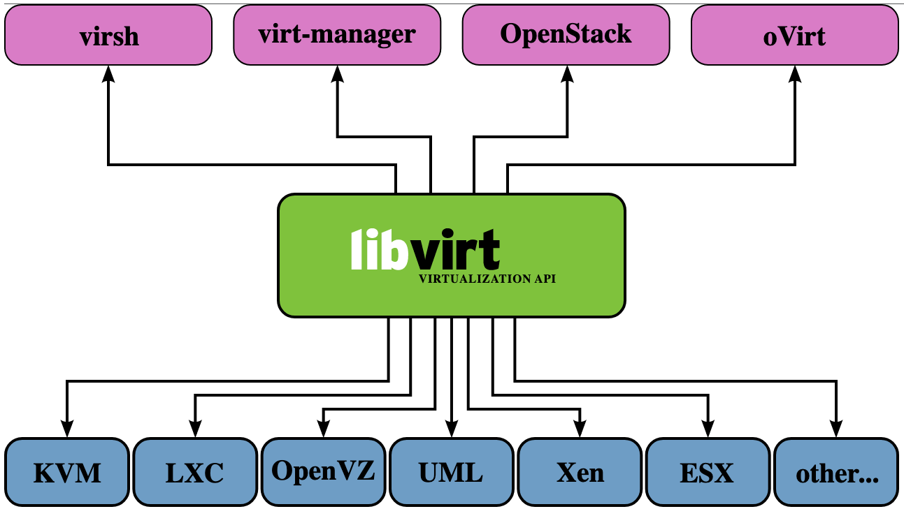
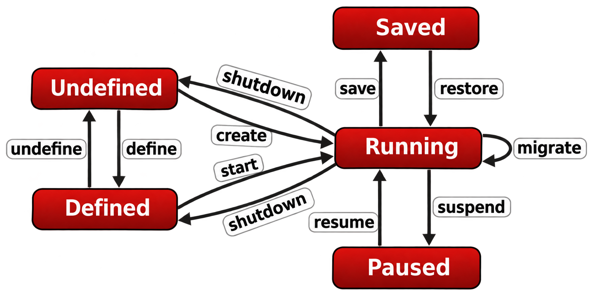
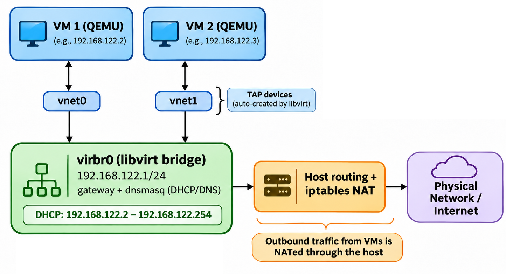

# libvirt

Libvirt is a toolkit that provides a consistent API for managing virtual machines across different hypervisors — including [QEMU/KVM](11_qemu_and_kvm.md), Xen, and VMware. Instead of invoking QEMU directly with long command-line flags, you describe a VM in an XML file and let libvirt handle the rest.

Libvirt includes:

- **libvirtd** — a daemon that mediates between management tools and the hypervisor
- **virsh** — a command-line tool for managing VMs, networks, and storage
- **virt-install** — a tool for creating new VMs from the command line
- **virt-manager** — a graphical desktop application for VM management

## Installation

On Debian/Ubuntu-based systems:

```bash
sudo apt install libvirt-daemon-system
```

Verify the daemon is running:

```bash
sudo systemctl status libvirtd
```

The libvirt daemon (`libvirtd`) listens for API requests from clients like `virsh` and acts as a mediator between these clients and the hypervisor.



## Initial Configuration

To manage VMs without root privileges, add your user to the `libvirt` group:

```bash
sudo usermod -aG libvirt $(whoami)
```

Log out and back in for the change to take effect. By default, `libvirtd` listens on a Unix domain socket in `/var/run/libvirt`, and only members of the `libvirt` group can write to it.

Next, edit the QEMU configuration so libvirt runs VMs as your user:

```bash
sudo nano /etc/libvirt/qemu.conf
```

Find and uncomment the `user` and `group` directives, then set them:

```
user = "your-username"
group = "libvirt"
```

Restart the service for changes to take effect:

```bash
sudo systemctl restart libvirtd
```

## virsh

`virsh` is the primary command-line tool for managing VMs through libvirt. It supports a wide range of operations — creating, starting, stopping, and monitoring VMs, networks, and storage.

```bash
virsh --help
```

## Domains

In libvirt terminology, a **domain** is a virtual machine. Each domain is described by an XML configuration file that specifies its resources — name, memory, CPUs, disks, network interfaces, and other hardware.

The full XML format reference is available at [libvirt.org/formatdomain.html](https://libvirt.org/formatdomain.html).

### Creating a VM with libvirt

Create a 2 GB virtual disk image:

```bash
qemu-img create -f qcow2 alpine_x86.qcow2 2G
```

Create the XML configuration file below and save it as `alpine.xml`. Update the two `<source file>` paths to absolute paths on your system — libvirt requires absolute paths for disk images.

```xml
<domain type='kvm'>
  <name>alpine-vm</name>
  <memory unit='KiB'>524288</memory>
  <vcpu>2</vcpu>
  <os>
    <type arch='x86_64' machine='pc'>hvm</type>
  </os>
  <devices>
    <emulator>/usr/bin/qemu-system-x86_64</emulator>
    <disk type='file' device='cdrom'>
      <driver name='qemu' type='raw'/>
      <source file='/absolute/path/to/alpine.iso'/>
      <target dev='hdc'/>
      <readonly/>
    </disk>
    <disk type='file' device='disk'>
      <driver name='qemu' type='qcow2'/>
      <source file='/absolute/path/to/alpine_x86.qcow2'/>
      <target dev='hda'/>
    </disk>
    <serial type='pty'>
      <source path='/dev/pts/0'/>
      <target port='0'/>
    </serial>
    <console type='pty' tty='/dev/pts/0'>
      <source path='/dev/pts/0'/>
      <target port='0'/>
    </console>
    <interface type='network'>
      <mac address='52:54:00:6b:3c:58'/>
      <source network='default'/>
      <model type='virtio'/>
    </interface>
  </devices>
</domain>
```

Key elements in this configuration:

| Element | Purpose |
|---------|---------|
| `<memory>` | 512 MB RAM (524288 KiB) |
| `<vcpu>` | 2 virtual CPUs |
| `<disk device='cdrom'>` | Alpine ISO mounted as a CD-ROM for installation |
| `<disk device='disk'>` | The qcow2 image as the VM's hard drive |
| `<console>` | Serial console access (for `virsh console`) |
| `<interface>` | virtio NIC connected to the `default` network (see [Default Network](#default-network) below) |

### Starting and Managing a VM

Start the VM:

```bash
virsh create alpine.xml
```

Check the VM status:

```bash
virsh list
```

```
 Id   Name        State
---------------------------
 3    alpine-vm   running
```

Connect to the VM console:

```bash
virsh console alpine-vm
```

Once finished, shut down or force-stop the VM:

```bash
virsh shutdown alpine-vm   # graceful shutdown
virsh destroy alpine-vm    # force stop (like pulling the power)
```

### Transient vs. Persistent Domains

**Transient domains** exist only while they are running. The `virsh create` command starts a VM directly from an XML file — once it stops, the configuration is discarded. This is useful for testing or one-off tasks.

**Persistent domains** are registered with libvirt and survive shutdown and host reboot. Use `virsh define` to register, then `virsh start` to launch:

```bash
virsh define alpine.xml
```

```
Domain 'alpine-vm' defined from alpine.xml
```

```bash
virsh start alpine-vm
```

```
Domain 'alpine-vm' started
```



The key difference: `create` = transient (start and forget), `define` + `start` = persistent (registered, can be restarted later).

## Networking

In the XML configuration above, the network interface connects to the `default` network:

```xml
<interface type='network'>
    <source network='default'/>
    <model type='virtio'/>
</interface>
```

Libvirt creates a `default` virtual network during installation. It uses NAT to give VMs internet access — similar to [QEMU's user-mode networking](17_networking_modes_qemu.md#user-mode-networking-slirp) but managed through libvirt with a proper bridge.

Inspect it with:

```bash
virsh net-dumpxml default
```

```xml
<network connections='1'>
  <name>default</name>
  <forward mode='nat'>
    <nat>
      <port start='1024' end='65535'/>
    </nat>
  </forward>
  <bridge name='virbr0' stp='on' delay='0'/>
  <mac address='52:54:00:e3:b0:69'/>
  <ip address='192.168.122.1' netmask='255.255.255.0'>
    <dhcp>
      <range start='192.168.122.2' end='192.168.122.254'/>
    </dhcp>
  </ip>
</network>
```

| Component       | Role |
|-----------------|------|
| `virbr0`        | Virtual bridge acting as a switch for VMs |
| `192.168.122.1` | The bridge's IP address (also the gateway for VMs) |
| DHCP range      | `192.168.122.2` – `192.168.122.254` |
| NAT             | Translates VM private IPs to the host's IP for outbound traffic |

When a VM starts, libvirt automatically creates a TAP interface (`vnet0`, `vnet1`, etc.) and attaches it to `virbr0` — like plugging a cable into a virtual switch. QEMU reads and writes the VM's network traffic through this TAP device. A `dnsmasq` process running on `virbr0` assigns the VM an IP via DHCP. Outbound traffic is NATed through the host's IP; inbound connections from outside are not possible without additional configuration. When the VM stops, libvirt closes the TAP file descriptor and the kernel automatically removes it.

This is the same [TAP + Bridge](17_networking_modes_qemu.md#tap--bridge) mechanism covered in the previous chapter — but libvirt automates the entire setup.



## virt-viewer

`virt-viewer` is a lightweight graphical tool for connecting to VM consoles managed by libvirt. It supports two display protocols:

- **SPICE** — higher performance, dynamic resolution changes, clipboard sharing
- **VNC** — broader compatibility, simpler setup

Install it with:

```bash
sudo apt install virt-viewer
```

To enable graphical console access, add display configuration to the domain XML (inside `<devices>`):

```xml
<graphics type='spice' port='3001' autoport='yes' listen='0.0.0.0'>
    <listen type='address' address='0.0.0.0'/>
    <image compression='off'/>
</graphics>

<graphics type='vnc' port='5901' autoport='yes' listen='0.0.0.0'>
    <listen type='address' address='0.0.0.0'/>
</graphics>
```

Query the display URI for a running VM:

```bash
virsh domdisplay --type spice alpine-vm
```

```
spice://localhost:5900
```

```bash
virsh domdisplay --type vnc alpine-vm
```

```
vnc://localhost:1
```

## virt-install

`virt-install` is a command-line tool for creating new VMs without manually writing XML. It generates the domain configuration from command-line options.

Install it with:

```bash
sudo apt install virtinst
```

Create an Alpine Linux VM with a graphical window:

```bash
virt-install \
    --name alpine-vm-2 \
    --os-variant alpinelinux3.18 \
    --memory 512 \
    --disk path=alpine_x86.qcow2,format=qcow2 \
    --cdrom path/to/alpine.iso \
    --boot cdrom
```

To run headless (no graphical window):

```bash
virt-install \
    --name alpine-vm-2 \
    --os-variant alpinelinux3.18 \
    --memory 512 \
    --disk path=alpine_x86.qcow2,format=qcow2 \
    --cdrom path/to/alpine.iso \
    --boot cdrom \
    --nographic
```

You can also pass raw QEMU options with `--qemu-commandline`:

```bash
virt-install \
    --name alpine-vm-2 \
    --os-variant alpinelinux3.18 \
    --memory 512 \
    --disk path=alpine_x86.qcow2,format=qcow2 \
    --cdrom path/to/alpine.iso \
    --boot cdrom \
    --nographic \
    --qemu-commandline="-serial tcp:127.0.0.1:4567,server,nowait"
```

## virt-manager

`virt-manager` (Virtual Machine Manager) is a graphical desktop application for managing VMs through libvirt. It provides a point-and-click interface for creating, configuring, and monitoring VMs — an alternative to `virsh` for users who prefer a GUI.

```bash
sudo apt install virt-manager
```

---

[← Previous: VirtualBox Networking Modes](18_networking_modes_virtualBox.md) | [Next: Vagrant →](20_vagrant.md)
