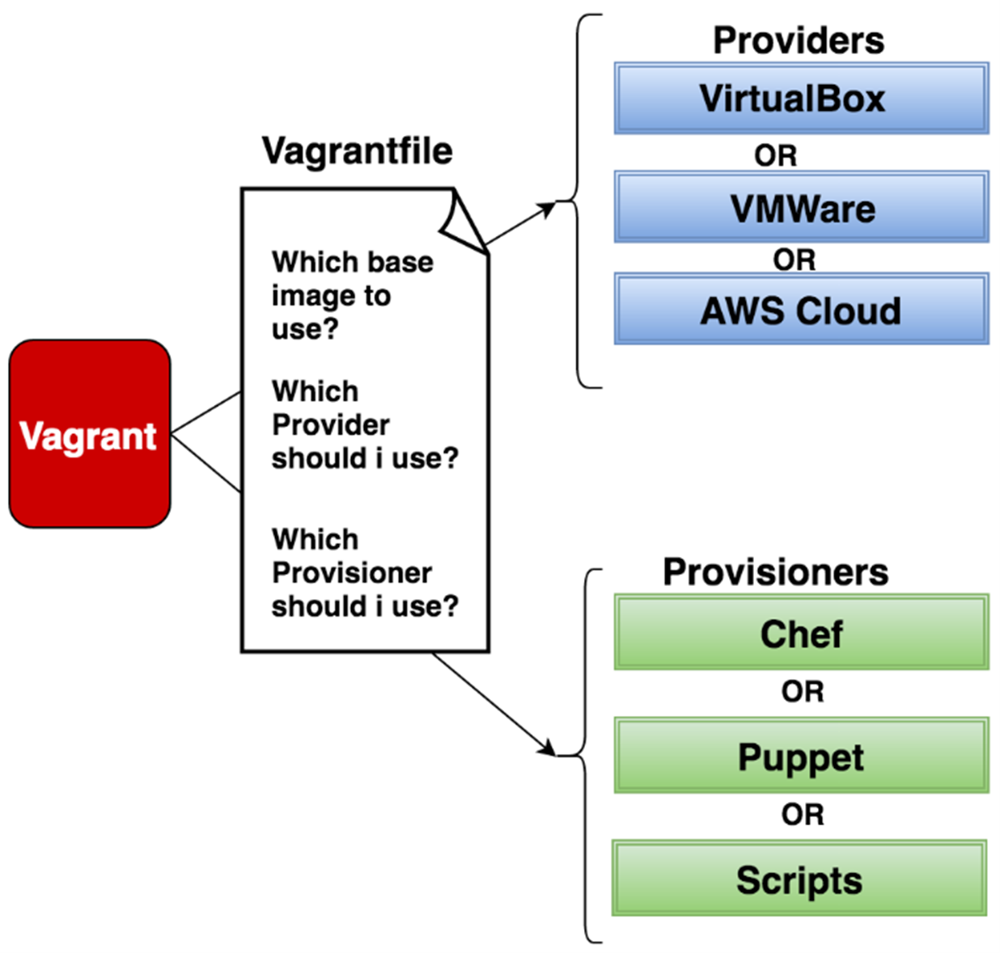

# Vagrant

The [previous chapter](19_libvirt.md) showed how libvirt simplifies VM management with XML configs and `virsh`. Vagrant takes this a step further — instead of writing XML and running `virsh` commands, you describe an entire environment in a single **Vagrantfile** and Vagrant handles provisioning, networking, and lifecycle management automatically. It can use libvirt, VirtualBox, or other hypervisors as its back-end provider.

Vagrant is an open-source tool by HashiCorp that provides a unified workflow for creating and managing virtualized development environments. It ensures that environments are consistent and reproducible across different machines and teams — a new team member can run `vagrant up` and have an identical environment in minutes.

## Installation

On Debian/Ubuntu:

```bash
sudo apt install vagrant
```

Full documentation: [developer.hashicorp.com/vagrant/docs](https://developer.hashicorp.com/vagrant/docs)

## Vagrantfile

The Vagrantfile is a Ruby-based configuration file that defines the settings and behavior of the virtual environment — the provider, base box, network settings, shared folders, and provisioning scripts.



### Providers

A **provider** is the virtualization platform that Vagrant uses to create and manage VMs. Vagrant was originally built for VirtualBox, but now supports multiple providers:

- **VirtualBox** — built-in, no plugin needed
- **Hyper-V** — built-in on Windows
- **Docker** — built-in (containers, not full VMs)
- **VMware** — via the `vagrant-vmware-desktop` plugin (recommended for production use)
- **libvirt/KVM** — via the `vagrant-libvirt` plugin

The provider is specified when you run `vagrant up` or configured in the Vagrantfile.

### Provisioners

**Provisioners** customize the VM after it has been created — installing software, configuring services, and performing setup tasks. This allows you to define the environment programmatically so it is set up correctly every time.

Common provisioners include:

- Shell scripts
- Ansible
- Chef
- Puppet
- Salt

### Boxes

A **box** is a base image of a VM that includes the operating system and potentially pre-installed software. Boxes serve as the starting point for provisioning — Vagrant downloads the box, creates a VM from it, then applies your provisioning scripts on top.

Boxes can be downloaded from [Vagrant Cloud](https://app.vagrantup.com/boxes/search) or custom-built and shared among team members. Each box supports one or more providers (e.g., a box may be available for both VirtualBox and libvirt).

## Plugins

Vagrant's functionality can be extended with plugins. While VirtualBox, Hyper-V, and Docker are supported out of the box, other providers require a plugin:

```bash
vagrant plugin install vagrant-libvirt
vagrant plugin install vagrant-vmware-desktop
```

List installed plugins:

```bash
vagrant plugin list
```

A full list of community plugins is available at the [Vagrant plugins wiki](https://github.com/hashicorp/vagrant/wiki/Available-Vagrant-Plugins).

## Example: Creating a VM

Initialize a new Vagrant project with a box from Vagrant Cloud:

```bash
mkdir vagrant-ubuntu && cd vagrant-ubuntu
vagrant init generic/ubuntu2310
```

This creates a `Vagrantfile` in the current directory, pre-configured to use the `generic/ubuntu2310` box.

Start the VM (this downloads the box on first run):

```bash
vagrant up --provider=libvirt
```

SSH into the running VM:

```bash
vagrant ssh
```

When finished, stop or destroy the VM:

```bash
vagrant halt      # shut down (preserves the VM)
vagrant destroy   # delete the VM entirely
```

## Common Commands

| Command | Description |
|---------|-------------|
| `vagrant init <box>` | Create a Vagrantfile for a box |
| `vagrant up` | Create and start the VM |
| `vagrant ssh` | SSH into the running VM |
| `vagrant halt` | Gracefully shut down the VM |
| `vagrant destroy` | Delete the VM and its disk |
| `vagrant reload` | Restart the VM (re-reads Vagrantfile) |
| `vagrant status` | Show the current VM state |
| `vagrant provision` | Re-run provisioning scripts |
| `vagrant box list` | List downloaded boxes |

---

[← Previous: libvirt](19_libvirt.md) | [Next: OS-Level Virtualization →](21_os_virtualization.md)
