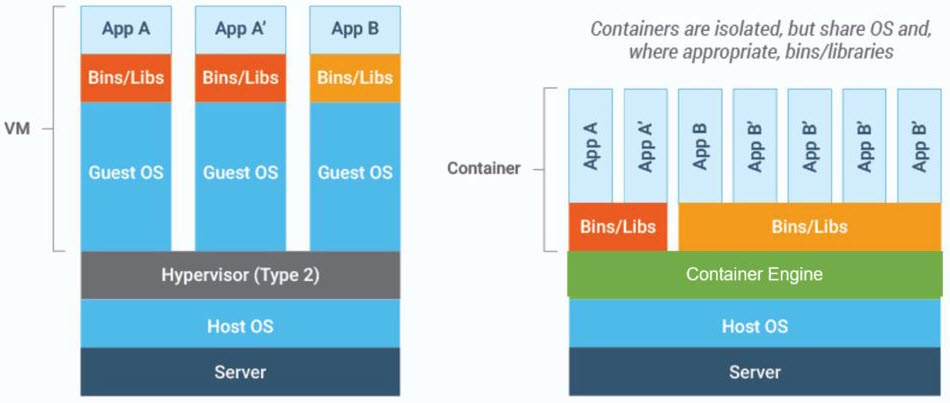

# OS-Level Virtualization

The previous chapters covered hardware virtualization — hypervisors, QEMU, KVM, virtual networking, and management tools like libvirt and Vagrant. All of these technologies run full virtual machines, each with its own guest OS kernel. This chapter introduces a fundamentally different approach: **OS-level virtualization** (commonly called **containerization**), where multiple isolated environments share a single host kernel.

## VMs vs. Containers

The diagram below illustrates the key architectural difference:

On the left, three applications — App A, App A′, and App B — each run inside a separate **VM**. Every VM carries its own full guest OS and its own copy of the binaries and libraries the application needs. Even when two VMs run the same application (App A and App A′), each still has a complete, independent OS stack. A hypervisor sits beneath all three VMs, managing access to the physical server.

On the right, the same applications run as **containers**. There is no guest OS layer — all containers share the host OS kernel and are isolated at the process level using two key Linux kernel features:

- **Namespaces** — give each container its own view of system resources (process IDs, network interfaces, filesystems, hostnames), so processes inside one container cannot see or affect processes in another.

- **Cgroups** (control groups) — limit and track how much CPU, memory, and I/O each container can use, preventing any single container from monopolizing host resources.

Each container has its own isolated filesystem and can carry different library versions without affecting other containers. Containers built from the same base image share the underlying image layers on disk through a **copy-on-write** (CoW) filesystem — a mechanism where shared data is only duplicated when a container modifies it, so the storage cost of common layers is paid only once. This eliminates redundancy and allows far more instances to fit on the same host.

## When to Use VMs vs. Containers

| Criteria | Virtual Machines | Containers |
| --- | --- | --- |
| Isolation level | Hardware-level (separate kernel per VM) | Process-level (shared host kernel) |
| Overhead | High — full OS per VM | Low — shared kernel, minimal footprint |
| Startup time | Minutes | Seconds |
| Best for | Running different OSes, strong security isolation, compliance requirements | Rapid deployment, scaling, portability, CI/CD pipelines |
| Example | Running Windows and Linux side by side on the same host | Deploying 50 instances of a web service behind a load balancer |

VMs and containers are not mutually exclusive — in practice, containers often run inside VMs to combine the security isolation of hardware virtualization with the efficiency of containerization. [Chapter 34](34_lightweight_virtualization.md) explores technologies that bridge this gap.

## Container Benefits and Trade-offs

### What Containers Offer

**Portability.** A container bundles the application with its dependencies, libraries, and configuration into a single package. It runs the same way on a developer's laptop, a CI server, or the cloud — solving the classic "it works on my machine" problem.

**Dependency isolation.** Each container carries its own libraries and binaries. One container can use version 2 of a library while another uses version 3, with no conflicts. Without containers, upgrading a shared library for one application can break another — a common problem known as "dependency hell."

**Fault isolation.** Each container runs independently, so a crash or misconfiguration in one does not bring down the others. The blast radius of any failure is limited to the container it occurs in.

**Fast startup.** Containers start in seconds because there is no OS to boot — the application process launches directly. This enables rapid deployment and on-demand scaling.

**Independent updates.** You can upgrade one containerized service without touching anything else. Stop the old container, start the new one. Other services continue running unaffected.

**Microservices.** Containerization is well-suited to microservices architecture, where an application is built as a collection of small, independent services. Each service runs in its own container and can be deployed, scaled, and updated on its own schedule.

### What Containers Cost

Containers are not free. Here are the trade-offs that come with a container-based architecture:

**Disk footprint.** Each container carries its own filesystem layers — base OS packages, libraries, and tools. Even with shared base image layers (via copy-on-write), running many containers can consume significant disk space, especially when different containers use different base images.

**Memory overhead.** Each container has its own process namespace and typically runs its own management processes (logging agents, health checks, init systems). This per-container overhead — often tens of megabytes each — adds up on hosts running many containers.

**Operational complexity.** A container runtime (Docker, Podman, containerd), container networking, image registries, and volume mounts introduce more moving parts than running bare processes on the host. Teams must learn and maintain this additional infrastructure.

**Debugging.** Troubleshooting is less straightforward than on a bare host. You must `exec` into a container to inspect it, logs are spread across containers rather than in one place, and tools you expect on the host may not be installed inside the container image.

**Weaker isolation than VMs.** Containers share the host kernel. A kernel vulnerability can potentially compromise all containers on the host, whereas VMs each run their own kernel behind a hypervisor boundary. For workloads requiring strong security guarantees, containers alone may not be sufficient — see [Chapter 34](34_lightweight_virtualization.md) for technologies that close this gap.

## Containerization Timeline

Containerization is not a new concept. Various technologies have evolved over two decades:

| Technology | Year | Description |
| --- | --- | --- |
| HP-UX Secure Resource Partitions (SRP) | 2002 | Early OS-level isolation on HP-UX Unix systems |
| Solaris Containers (Zones) | 2004 | Lightweight virtualization built into Sun's Solaris OS |
| OpenVZ | 2005 | Linux container technology using a patched kernel |
| AIX Workload Partitions (WPARs) | 2007 | OS-level virtualization on IBM's AIX Unix |
| LXC (Linux Containers) | 2008 | First Linux container implementation using mainline kernel cgroups and namespaces |
| Docker | 2013 | Made containers accessible with a simple CLI, image format, and ecosystem |
| Podman | 2018 | Daemonless, rootless alternative to Docker with a compatible CLI |

## Docker and Podman

**Docker** is the technology that popularized containerization. It provides a simple CLI, a standardized image format, and a rich ecosystem (Docker Hub, Docker Compose, Docker Desktop). Docker uses a client-server model where the `docker` CLI sends commands to a background daemon (`dockerd`) that manages containers.

**Podman** offers a Docker-compatible CLI (`podman` commands mirror `docker` commands) but takes a different architectural approach — it runs without a central daemon and operates rootless by default, reducing the attack surface. Any `docker` command can be replaced with `podman` as a drop-in substitute.

Docker is covered in detail in [Chapters 22–33](22_docker.md).

---

[← Previous: Vagrant](20_vagrant.md) | [Next: Docker →](22_docker.md)
