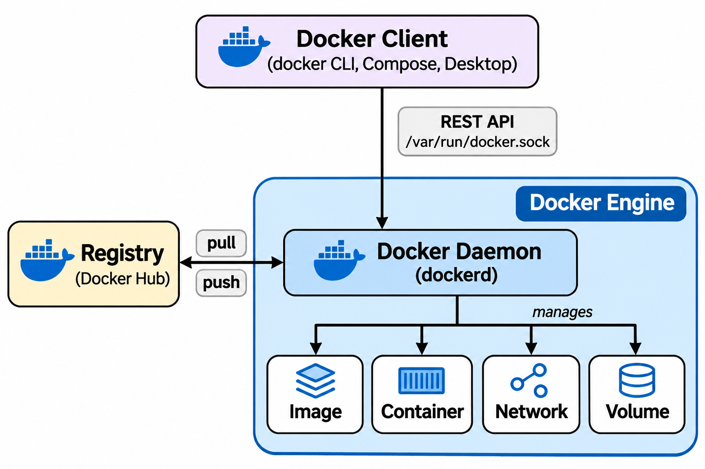

# Docker

The [previous chapter](21_os_virtualization.md) introduced containerization and compared it to hardware virtualization. Docker is the platform that brought containers into mainstream use. It provides a simple CLI, a standardized image format, and a rich ecosystem of tools — making it easy to build, ship, and run applications in isolated containers.

> Docker is available on Linux, macOS, and Windows. See the [official documentation](https://docs.docker.com/engine/install/) for platform-specific instructions.

On Ubuntu/Debian, the quick setup is:

```bash
# Install Docker Engine
curl -fsSL https://get.docker.com | sudo sh

# Add your user to the docker group (avoids needing sudo for every command)
sudo usermod -aG docker $USER

# Log out and back in for the group change to take effect
logout
```

After logging back in, verify the installation:

```bash
docker run hello-world
```

## Quick Example: Running Nginx

To illustrate Docker's simplicity, here is a complete workflow — pull an image, run a container, verify, and clean up:

```bash
docker pull nginx
```

This downloads the official Nginx image from [Docker Hub](https://hub.docker.com/) and stores it locally.

Start a container from the image:

```bash
docker run --name my-nginx -d -p 80:80 nginx
```

| Flag              | Meaning                            |
| ----------------- | ---------------------------------- |
| `--name my-nginx` | Assigns a human-readable name to the container |
| `-d`              | Runs in detached mode (background) |
| `-p 80:80`        | Maps host port 80 to container port 80 |

The `--name` flag is optional — if omitted, Docker auto-generates a random name like `jolly_curie` or `angry_morse` (a combination of an adjective and a famous scientist). While fun, these names are hard to remember and make it difficult to manage containers later with `docker stop`, `docker logs`, or `docker exec`. Explicitly naming your containers is a good habit, especially when running multiple containers.

Verify the container is running:

```bash
docker ps
```

Open [http://localhost](http://localhost) in a browser — you should see the Nginx welcome page.

Stop and remove the container:

```bash
docker stop my-nginx
docker rm my-nginx
```

Or combine both into a single step with the force flag:

```bash
docker rm -f my-nginx
```

### Why This Matters

Compare the Docker workflow above to a traditional deployment:

| Task | Traditional Deployment | Docker |
| --- | --- | --- |
| Install dependencies | Manually install Nginx via the OS package manager; resolve library conflicts | `docker pull nginx` — one command |
| Configure the server | Edit config files; handle conflicts with existing software | Configuration is baked into the image |
| Manage versions | Track Nginx versions across dev, staging, and production manually | Pin a specific image tag (e.g., `nginx:1.25`) |
| Environment consistency | "Works on my machine" problems due to OS/library differences | Same image runs identically everywhere |
| Isolation | Multiple apps on one server can conflict | Each container is isolated from others |

## Docker Architecture

Docker uses a **client-server** model. The Docker client sends commands to the Docker daemon, which does the actual work of building images and running containers.



The deeper internals (containerd, runc, shim) are covered in [Chapter 32 — Docker Internals](32_docker_internals.md).

### Docker Daemon (`dockerd`)

The daemon is the background service that manages containers, images, networks, and volumes. It listens for API requests from the Docker client and handles all container lifecycle operations. On Linux, it runs as a systemd service:

```bash
systemctl status docker
```

```
● docker.service - Docker Application Container Engine
    Loaded: loaded (/lib/systemd/system/docker.service; enabled)
    Active: active (running)
   Main PID: 1225 (dockerd)
```

If the daemon is not running, all `docker` commands will fail.

The diagram above shows the four core objects that the daemon manages:

| Component | Description |
| --- | --- |
| **Images** | Read-only packages containing an application and its dependencies, built from a Dockerfile or pulled from a registry |
| **Containers** | Isolated processes with their own filesystem, networking, and process tree, launched from an image |
| **Networks** | Virtual networks that connect containers to each other and to the host |
| **Volumes** | Persistent storage that survives container restarts and removal |

### Docker Client

The Docker client is the primary interface for interacting with the daemon. The most common client is the `docker` CLI:

```bash
docker run ...       # create and start a container
docker ps            # list running containers
docker exec ...      # execute a command inside a running container
docker build ...     # build an image from a Dockerfile
```

Other client options include **Docker Desktop** (a GUI for macOS, Windows, and Linux) and the **Docker Engine API** for programmatic automation.

### Client-Server Communication

On a local machine, the client communicates with the daemon through a Unix domain socket at `/var/run/docker.sock`. This provides efficient interprocess communication without using a network port.

The client can also connect to a **remote** daemon over TCP, enabling management of Docker hosts on other machines.

> **Security note:** Any process with write access to `docker.sock` can issue Docker commands and potentially gain root privileges on the host. Restrict socket access to trusted users (e.g., the `docker` group) and avoid exposing it unnecessarily.

### Docker Hub (Registry)

[Docker Hub](https://hub.docker.com/) is the default public registry where images are stored and shared. When you run `docker pull nginx`, Docker downloads the image from Docker Hub. Organizations can also run **private registries** for proprietary images.

---

[← Previous: OS-Level Virtualization](21_os_virtualization.md) | [Next: Docker Commands →](23_docker_commands.md)
