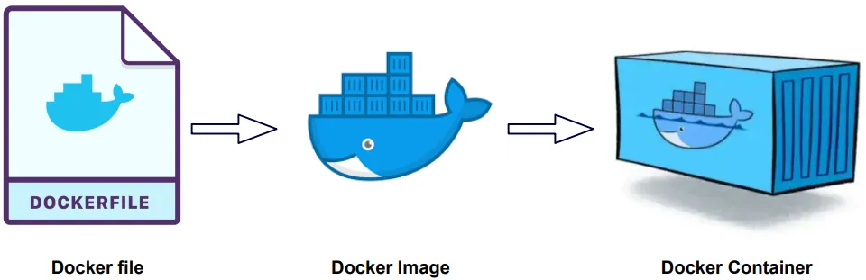
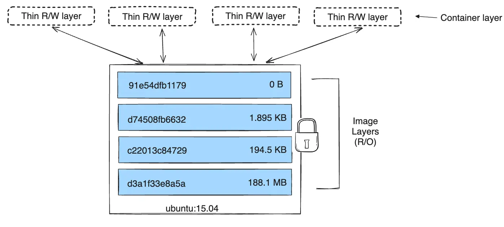
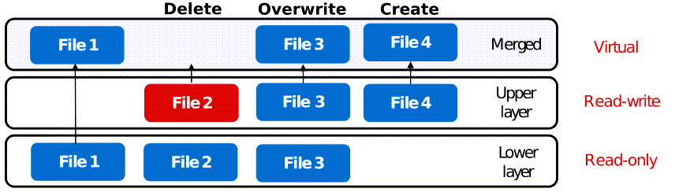

# Docker Images

This chapter focuses on **images** — the read-only packages that contain an application and its dependencies. Images are built from Dockerfiles, stored in registries, and used to launch containers.

## Dockerfile → Image → Container

A **Dockerfile** is a plain-text file containing instructions that Docker uses to build an image. The image is then used to create running containers.



### Example: Building an Nginx Image

Create a simple `index.html`:

```html
<!DOCTYPE html>
<html>
  <head>
      <title>Welcome to Nginx</title>
  </head>
  <body>
      <h1>Hello, World!</h1>
      <p>This is a simple Nginx web server.</p>
  </body>
</html>
```

Create a `Dockerfile` in the same directory:

```dockerfile
FROM nginx:latest
COPY index.html /usr/share/nginx/html/
EXPOSE 80
RUN apt-get update && apt-get install -y curl && apt-get clean
CMD ["nginx", "-g", "daemon off;"]
```

Build the image:

```bash
docker build --tag my-nginx-img .
```

Docker looks for a file named `Dockerfile` in the specified directory (`.`). To use a different filename, pass `-f`:

```bash
docker build -f MyDockerfile --tag my-nginx-img .
```

Verify the image was created:

```bash
docker images
```

```
REPOSITORY      TAG       IMAGE ID       CREATED           SIZE
my-nginx-img    latest    7b55f7c6da47   15 seconds ago    188MB
```

Run a container from the image:

```bash
docker run --name my-nginx -d -p 80:80 my-nginx-img
```

Dockerfile instructions (`FROM`, `RUN`, `COPY`, `CMD`, etc.) are covered in detail in the [next chapter](25_dockerfile_instructions.md).

## Docker Registry

A registry is a service that stores and distributes Docker images. Registries can be public or private:

| Type | Examples |
| --- | --- |
| Public | [Docker Hub](https://hub.docker.com/) (default) |
| Private | Harbor, AWS ECR, Google GCR, Azure ACR |

**Docker Hub** is the default registry. When you run `docker pull nginx`, Docker downloads the image from Docker Hub. Similarly, `docker push` uploads to Docker Hub unless a different registry is specified:

```bash
docker pull nginx                      # pulls from Docker Hub
docker push myusername/myimage         # pushes to Docker Hub
```

When a Dockerfile's `FROM` instruction specifies an image without a registry prefix, Docker looks for it on Docker Hub.

## Image Tags

A **tag** is a label that identifies a specific version or variant of an image. If no tag is specified, Docker defaults to `latest`.

```bash
docker pull nginx              # same as nginx:latest
docker pull nginx:1.25.3       # specific version
docker pull ubuntu:24.04       # Ubuntu Noble Numbat
docker pull ubuntu:focal       # Ubuntu 20.04 by name
```

You can browse available tags for any image on [Docker Hub](https://hub.docker.com/).

### Slim and Alpine Variants

Many images offer lightweight variants to reduce size and attack surface:

| Variant | Description | Example |
| --- | --- | --- |
| **Full** | Includes common tools and libraries for broad compatibility | `python:3.12` |
| **Slim** | Strips optional tools; includes only essentials to run the app | `python:3.12-slim` |
| **Alpine** | Based on Alpine Linux (~5 MB base); smallest option | `nginx:alpine` |

Smaller images pull faster, start faster, and consume fewer resources — making them preferred for production deployments.

## Image Layers

Every Docker image is composed of **layers** stacked on top of each other. Each Dockerfile instruction (`FROM`, `RUN`, `COPY`, `ADD`) creates a new layer representing filesystem changes.

Use `docker history` to inspect an image's layers:

```bash
docker history my-nginx-img
```



### Read-Only Layers and the Writable Container Layer

Image layers are **read-only**. When a container starts, Docker adds a thin **read-write layer** on top — the **container layer**. All modifications (new files, edits, deletions) happen in this writable layer.

| Layer Type | Lifetime | Shared? |
| --- | --- | --- |
| Image layers (read-only) | Persist until the image is deleted | Shared across all containers using the same image |
| Container layer (read-write) | Exists only while the container exists | Private to each container |

When a container is deleted, its writable layer is discarded — the underlying image remains unchanged. Multiple containers can share the same image while maintaining their own independent state.

### How It Works: OverlayFS

The layer system described above is implemented using **OverlayFS** — a Linux **union filesystem** that merges multiple directories into a single unified view. OverlayFS is Docker's default storage driver.

OverlayFS combines three directories:

| Directory | Role | Maps To |
|-----------|------|---------|
| `merged`   | Combined view presented to the container | What the container sees as `/` |
| `upperdir` | Read-write layer for changes | Container layer |
| `lowerdir` | Read-only base layers | Image layers |



The diagram shows four files, each illustrating a different OverlayFS behavior:

| File | Lower Layer | Upper Layer | Merged View | What Happened |
|------|-------------|-------------|-------------|---------------|
| **File 1** | ✅ exists | — | ✅ visible | **Pass-through** — read directly from lower layer |
| **File 2** | ✅ exists | 🔴 whiteout | ❌ hidden | **Delete** — whiteout marker hides it from merged view |
| **File 3** | ✅ exists | ✅ new version | ✅ upper wins | **Overwrite** — copied to upper layer (copy-on-write), upper version wins |
| **File 4** | — | ✅ exists | ✅ visible | **Create** — new file, exists only in upper layer |

In all four cases, the lower layer is **never modified** — it remains read-only. This is why multiple containers can share the same image layers safely; each container gets its own upper layer for changes.

The whiteout mechanism (File 2) is why deleting files in a later Dockerfile instruction does not reduce image size — the original data still occupies space in the lower layer. See [Chapter 26 — Best Practices](26_best_practice.md) for techniques to avoid this.

You can see Docker's OverlayFS mounts on the host:

```bash
docker inspect my-nginx --format '{{.GraphDriver.Data.MergedDir}}'
```

This returns the path to the `merged` directory on the host filesystem — the same content the container sees as its root filesystem.

### Pull Caching

Each layer is identified by a unique **digest** (cryptographic hash). When you pull an image, Docker checks the local cache:

- If a layer already exists locally → **reused** (no download)
- If a layer is missing → **downloaded** from the registry

This means pulling a new version of an image only downloads the layers that changed — saving bandwidth and time.

### Build Caching

Docker also caches layers during `docker build`. If a Dockerfile instruction and its inputs haven't changed since the last build, Docker reuses the cached layer instead of re-executing the instruction.

Cache invalidation is **sequential** — if one layer changes, all subsequent layers are rebuilt. To maximize cache efficiency:

> **Tip:** Order Dockerfile instructions from least to most frequently changing. Put `COPY package.json package-lock.json ./` and `RUN npm install` before `COPY . .` so that dependency installation is cached unless dependencies change.

See [Chapter 26 — Best Practices](26_best_practice.md#balance-layers-for-cache-efficiency) for a detailed walkthrough of cache-efficient layer ordering.

Example — rebuild with a change:

```bash
docker build --tag my-nginx-img:v2 .
```

If only the `RUN` instruction changed, Docker reuses cached layers for `FROM`, `COPY`, and `EXPOSE`, and only rebuilds from the changed instruction onward.

## Dangling Images

A **dangling image** is an untagged image (`<none>:<none>`) that is no longer referenced by any tagged image or container. These accumulate when you rebuild an image with the same tag — the old image loses its tag and becomes dangling.

List dangling images:

```bash
docker images -f "dangling=true"
```

```
REPOSITORY   TAG       IMAGE ID       CREATED          SIZE
<none>       <none>    d6c38b8d8b2a   29 seconds ago   123MB
```

Remove them:

```bash
docker image prune
```

### Creating a Dangling Image (Walkthrough)

The following example demonstrates exactly how a dangling image is created. Start with a simple Dockerfile:

```dockerfile
FROM ubuntu:latest
RUN apt-get update && apt-get install -y curl
```

Build and tag it:

```bash
docker build --tag my-image .
```

Now add a new instruction to the Dockerfile:

```dockerfile
FROM ubuntu:latest
RUN apt-get update && apt-get install -y curl
RUN echo "This is a new layer" > /new-layer.txt
```

Rebuild with the **same tag**:

```bash
docker build --tag my-image .
```

The `my-image:latest` tag now points to the new image. The previous image loses its tag and becomes dangling:

```bash
docker images -f "dangling=true"
```

```
REPOSITORY   TAG       IMAGE ID       CREATED          SIZE
<none>       <none>    d6c38b8d8b2a   29 seconds ago   123MB
```

The `<none>:<none>` entry is the old `my-image` — it still exists on disk but is no longer tagged or referenced.

## Build Context

The **build context** is the directory sent to the Docker daemon when you run `docker build`. It contains the Dockerfile and any files referenced by `COPY` or `ADD` instructions.

```bash
docker build --tag my-image .
```

The `.` specifies the current directory as the context. `COPY app.py /app/app.py` works only if `app.py` is inside this context directory.

### .dockerignore

Docker transfers the **entire** context directory to the daemon before building. Large or unnecessary files slow down the build. A `.dockerignore` file excludes files from the context, similar to `.gitignore`:

```
.git
node_modules
*.log
__pycache__
```

## Multi-Stage Builds

Multi-stage builds use multiple `FROM` statements in a single Dockerfile to separate the **build environment** from the **runtime environment**. Only the necessary artifacts are copied from one stage to the next, resulting in a much smaller final image.

### Example: Go Application

The build context contains two files — `main.go` and `Dockerfile`:

```go
// main.go
package main

import "fmt"

func main() {
    fmt.Println("Hello, World!")
}
```

```dockerfile
# Stage 1: Build
FROM golang:1.21 AS builder
WORKDIR /app
COPY . .
RUN go build -o myapp

# Stage 2: Runtime
FROM alpine:latest
COPY --from=builder /app/myapp /usr/local/bin/myapp
CMD ["myapp"]
```

| Stage | Base Image | Purpose | Size |
| --- | --- | --- | --- |
| 1 (builder) | `golang:1.21` (~800 MB) | Compile the Go binary | Discarded after build |
| 2 (final) | `alpine:latest` (~5 MB) | Run the compiled binary | Kept as the final image |

The first stage compiles the application. The second stage copies only the compiled binary into a minimal Alpine image. The final image is a few MB instead of ~800 MB — the Go compiler, source code, and build tools are not included.

---

[← Previous: Docker Commands](23_docker_commands.md) | [Next: Dockerfile Instructions →](25_dockerfile_instructions.md)
