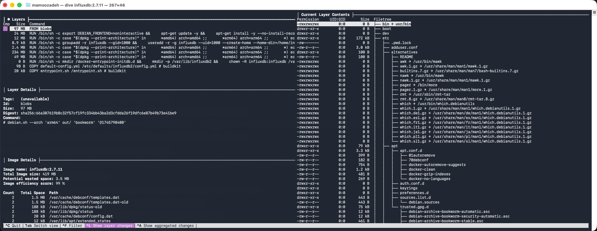

# Docker Best Practices

The [previous chapter](25_dockerfile_instructions.md) covered individual Dockerfile instructions. This chapter focuses on **how to use them effectively** — writing Dockerfiles that produce small, fast, and cache-friendly images.

## Layer Immutability and Whiteout Files

As covered in [Chapter 24](24_docker_image.md#image-layers), every Docker image is a stack of read-only layers. Once a layer is created, its contents can never be altered. If a later instruction modifies or deletes a file, Docker does not edit the previous layer — it creates a new layer that records the change.

When a file is deleted in a later layer, Docker writes a **whiteout file** in the upper layer to mark that path as removed. At runtime, [OverlayFS](24_docker_image.md#how-it-works-overlayfs) hides the file from the merged view. However, the original data still exists in the lower layer.

This means **deleting files in a later layer does not reduce image size** — it only affects runtime visibility:

```dockerfile
RUN apt-get install -y build-essential   # Layer 1: ~90 MB added
RUN make build                           # Layer 2
RUN apt-get remove -y build-essential    # Layer 3: whiteout files added, Layer 1 unchanged
```

All three layers are stored and transferred. The final image is just as large as if the removal never happened.

## Combine Temporary Operations in a Single Layer

To truly avoid retaining unnecessary data, perform installation, usage, and cleanup within the **same `RUN` instruction**. Docker only commits the final filesystem state of that instruction into the layer:

```dockerfile
RUN apt-get update && \
    apt-get install -y build-essential && \
    make build && \
    apt-get remove -y build-essential && \
    apt-get clean && \
    rm -rf /var/lib/apt/lists/*
```

A single `RUN` executes in one intermediate container — Docker snapshots the filesystem only after the command finishes. Any files created and deleted during that command leave no trace in the committed layer.

This technique is important for:

- Compilers and build toolchains
- Package manager caches (`apt`, `pip`, `npm`)
- Temporary archives and intermediate build artifacts

## Balance Layers for Cache Efficiency

Combining everything into one `RUN` is **not** always the best approach. Each `RUN` instruction produces a distinct cacheable layer. Docker reuses cached layers if their instruction and inputs haven't changed — but cache invalidation is sequential: if one layer changes, **all subsequent layers are rebuilt**.

This creates two competing goals:

| Goal | Strategy |
| --- | --- |
| Small image size | Combine temporary operations in a single `RUN` |
| Fast rebuild times | Split stable and volatile steps into separate layers |

### Order by Change Frequency

Place instructions that change infrequently **early** in the Dockerfile, and frequently changing content **later**:

```dockerfile
# Rarely changes → cached effectively
RUN apt-get update && apt-get install -y some-base-dependency

# Changes when dependencies change
COPY package.json package-lock.json ./
RUN npm install

# Changes frequently (source code updates)
COPY . .
```

If you update a source file, Docker only rebuilds from the `COPY . .` step forward — system dependencies and `npm install` are reused from cache. If everything were in a single `RUN`, any change would force a full rebuild.

### The Practical Rule

- **Temporary data** (build tools, caches, archives): install, use, and clean up in **one `RUN`**.
- **Stable output** (system packages, dependency installs): isolate in **separate layers** to maximize cache reuse.

## Use Multi-Stage Builds

Multi-stage builds take this concept further by separating **build-time** and **runtime** environments entirely. Build artifacts are compiled in one stage (with compilers and heavy dependencies) and copied into a clean, minimal stage for production.

This eliminates build tools from the final image rather than merely cleaning them up:

- Smaller production images
- Reduced attack surface
- Faster deployment
- Cleaner separation of concerns

See [Chapter 24 — Multi-Stage Builds](24_docker_image.md#multi-stage-builds) for a complete walkthrough with a Go application example.

## APT Cleanup: `remove` vs `purge`

In Debian-based images, `apt-get remove` and `apt-get purge` behave differently:

| Command | Removes Binaries | Removes Config Files |
| --- | --- | --- |
| `apt-get remove` | ✅ | ❌ (leaves `/etc` config files) |
| `apt-get purge` | ✅ | ✅ |

On traditional servers, keeping configuration files is useful for reinstalling packages without losing settings. In Docker images, containers are ephemeral and rebuilt from scratch — leftover config files provide no benefit and only increase image size.

**Use `purge` in containers** when removing packages that are no longer needed.

### Full Cleanup Sequence

A complete container cleanup combines four steps. All four should be in the **same `RUN` instruction** to keep the layer minimal:

```dockerfile
RUN apt-get update && \
    apt-get install -y build-essential && \
    make build && \
    apt-get purge -y build-essential && \
    apt-get autoremove -y && \
    apt-get clean && \
    rm -rf /var/lib/apt/lists/*
```

| Step | What It Does |
| --- | --- |
| `apt-get purge -y <packages>` | Removes the package **and** its configuration files |
| `apt-get autoremove -y` | Removes orphaned dependencies that were pulled in automatically |
| `apt-get clean` | Deletes cached `.deb` files from `/var/cache/apt/archives/` |
| `rm -rf /var/lib/apt/lists/*` | Deletes repository metadata downloaded by `apt-get update` |

The `apt-get update` at the beginning and `rm -rf /var/lib/apt/lists/*` at the end form a pair — the metadata is needed only during the install step and can be safely removed from the final layer.

## Inspect Images with `dive`

[Dive](https://github.com/wagoodman/dive) is an open-source CLI tool that inspects Docker images **layer by layer**. Instead of treating an image as a black box, Dive shows which files were added, modified, or deleted in each layer.

Key features:

- **Interactive TUI** — Navigate through layers and inspect file changes in real time
- **Wasted space detection** — Highlights files added in one layer and deleted in a later layer (data that inflates image size but is invisible at runtime)
- **Efficiency score** — Calculates how well the image avoids wasted space
- **CI/CD integration** — Supports non-interactive mode with configurable thresholds, so builds can fail automatically if the image exceeds an inefficiency limit



## Quick Reference

| Best Practice | Why |
| --- | --- |
| Combine install + use + cleanup in one `RUN` | Prevents deleted files from bloating the image (whiteout files) |
| Order instructions by change frequency | Maximizes Docker build cache reuse |
| Use `purge` instead of `remove` | Removes config files, not just binaries |
| Run `autoremove`, `clean`, and `rm lists` | Cleans up orphaned deps, cached `.deb` files, and metadata |
| Use multi-stage builds for compiled languages | Eliminates build tools from the final image entirely |
| Use slim/Alpine base images | Reduces base image size from hundreds of MB to ~5 MB |
| Add a `.dockerignore` file | Prevents unnecessary files from entering the build context |
| Run as non-root (`USER`) | Limits damage if a container is compromised |
| Use `dive` to audit image efficiency | Detects wasted space and validates optimization efforts |

---

[← Previous: Dockerfile Instructions](25_dockerfile_instructions.md) | [Next: Docker Containers →](27_docker_container.md)
