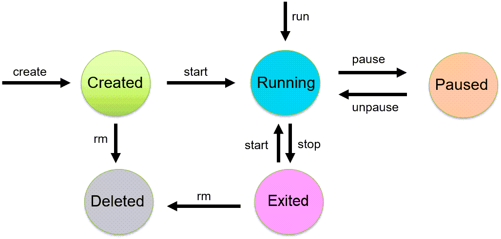

# Docker Containers

This chapter focuses on **running containers** — executing commands inside them, understanding the main process and PID namespaces, and managing the container lifecycle.

## Executing Commands in a Running Container

The `docker exec` command runs a command inside an **already running** container:

```bash
docker exec my-app ls /var/log
docker exec my-app ps aux
```

To open an interactive shell inside the container, use the `-it` flags:

```bash
docker exec -it my-app /bin/bash
```

| Flag | Meaning                                     |
| ---- | ------------------------------------------- |
| `-i` | Keeps STDIN open (allows you to type input) |
| `-t` | Allocates a pseudo-TTY (provides a terminal interface) |

Together, `-it` gives you a shell session inside the container as if you were logged into it — useful for debugging, inspecting logs, or running administrative commands.

> **Note:** You may see suggestions to SSH into a container. This requires installing and configuring an SSH server inside the container, which adds overhead, increases the image size, and creates an unnecessary attack surface. Use `docker exec` instead — it provides the same access without any additional setup.

## The Main Process (PID 1)

Every container has a **main process** defined by the `CMD` or `ENTRYPOINT` instruction in its Dockerfile. This process runs as **PID 1** inside the container.

Docker uses Linux PID namespaces to give each container its own isolated process tree. The first process in the container's namespace receives PID 1 — even though the same process has a completely different PID on the host.

### Inspecting the Host PID

You can observe this PID mapping with a running Nginx container:

```bash
docker run --name my-nginx -d -p 80:80 nginx
```

Use `docker top` to view the container's processes **from the host**:

```bash
docker top my-nginx
```

```
UID    PID     PPID    CMD
root   25966   25940   nginx: master process nginx -g daemon off;
root   26010   25966   nginx: worker process
```

The `PID` column shows the **host PIDs**. Inside the container, the master process runs as PID 1 — but from the host's perspective it is PID 25966.

You can also retrieve the host PID programmatically with `docker inspect`:

```bash
docker inspect --format '{{.State.Pid}}' my-nginx
# 25966
```

The container sees PID 1; the host sees PID 25966. Both refer to the same process.

### Blocking vs Non-Blocking Processes

Docker ties the container lifecycle to its main process — **when PID 1 exits, the container stops**. This means the main process must be long-running (blocking):

| Main Process             | Behavior |
| ------------------------ | --- |
| `nginx -g "daemon off;"` | Blocking — container stays running |
| `echo "hello"`           | Non-blocking — container exits immediately |
| `tail -f /dev/null`      | Blocking — keeps container alive (useful for debugging) |

### Inspecting the Default CMD

Every image has a default `CMD`. Use `docker inspect` to see it:

```bash
docker inspect nginx --format '{{json .Config.Cmd}}'
# ["nginx","-g","daemon off;"]

docker inspect ubuntu:24.04 --format '{{json .Config.Cmd}}'
# ["/bin/bash"]
```

Nginx runs a blocking web server — the container stays running in detached mode. Ubuntu's default is `/bin/bash`, which exits immediately without a terminal attached. To keep it running, add `-it`:

```bash
docker run -d -it --name my-ubuntu ubuntu:24.04
```

## Container Lifecycle

A container transitions through several states during its lifetime. Docker defines **seven** official states:



| Action | Current State | Next State | Command |
| --- | --- | --- | --- |
| Create | — | Created | `docker create <image>` |
| Run | — | Running | `docker run <image>` |
| Start | Created / Exited | Running | `docker start <container>` |
| Pause | Running | Paused | `docker pause <container>` |
| Unpause | Paused | Running | `docker unpause <container>` |
| Stop | Running | Exited | `docker stop <container>` |
| Kill | Running | Exited | `docker kill <container>` |
| *(restart policy)* | Exited | Restarting → Running | Automatic (see [Restart Policies](#restart-policies)) |
| Remove | Created / Exited | Removing → Deleted | `docker rm <container>` |

### Created

The container exists and has been allocated resources, but its main process has not started.

```bash
docker create --name my-container my-image
docker ps -a
```

```
CONTAINER ID   IMAGE      COMMAND       CREATED         STATUS    NAMES
e22155f51281   my-image   "/bin/bash"   6 seconds ago   Created   my-container
```

Start it later with `docker start my-container`. Pre-creating containers is useful when you want to validate configuration ahead of time (e.g., containers scheduled to start via a cron job).

### Running

The container's main process is executing. `docker run` combines `create` + `start` in one step:

```bash
docker run -d --name my-app my-image
```

### Paused

All processes in the container are suspended but remain in memory. The container can be resumed instantly:

```bash
docker pause my-app
docker unpause my-app
```

Useful for temporarily freeing CPU resources without stopping the container.

### Exited

The container is no longer active — either the main process finished, it was stopped, or it crashed.

**Graceful stop (`docker stop`):** Docker sends `SIGTERM` to PID 1, giving the process up to **10 seconds** (configurable with `-t`) to clean up and exit. If the process doesn't stop within the grace period, Docker sends `SIGKILL` to force termination.

```bash
docker stop my-app          # SIGTERM → wait 10s → SIGKILL
docker stop -t 30 my-app    # SIGTERM → wait 30s → SIGKILL
```

**Forced stop (`docker kill`):** Sends `SIGKILL` immediately — no grace period, no cleanup. Use when a container is unresponsive.

```bash
docker kill my-app
```

### Restarting

A transitional state entered when the container's main process has exited and a restart policy is in effect. Docker waits with an exponential backoff (starting at ~100 ms, up to a 1-minute cap) before restarting the container. The container transitions back to **Running** on success, or to **Exited** if the restart policy's retry limit is reached. See [Restart Policies](#restart-policies) below.

### Removing

A transitional state entered when `docker rm` is in progress. The container's writable layer and associated resources are being cleaned up. Once complete, the container is fully deleted.

### Dead

The container is in a defunct state — Docker attempted to remove it but failed, usually because a mount or resource was busy. Dead containers cannot be started; they can only be removed. Retry with `docker rm -f`, or restart the Docker daemon (which automatically attempts to clean up dead containers).

## Restart Policies

Docker can automatically restart containers when they exit. This is configured with the `--restart` flag at container creation. The policy determines whether a container enters the **Restarting** state or stays **Exited** after its main process terminates:

| Policy | Behavior | Use Case |
| --- | --- | --- |
| `no` (default) | Never restarts automatically | Manual control only |
| `always` | Always restarts, regardless of exit status | Services that must always be available |
| `unless-stopped` | Like `always`, but not if manually stopped | Services that should run unless explicitly stopped |
| `on-failure[:N]` | Restarts only on non-zero exit code; optional max retries | Restart on error but not on clean exit |

```bash
docker run -d --restart=always my-app
docker run -d --restart=on-failure:3 my-app
```

## Automatic Removal with `--rm`

By default, stopped containers remain on disk (visible in `docker ps -a`). Over time they accumulate and consume storage. The `--rm` flag tells Docker to remove the container automatically when it exits:

```bash
docker run --rm my-image
```

This is ideal for one-off tasks — running scripts, processing data, executing tests — where you don't need to inspect the container after it finishes.

## What Happens to Data in Each State?

When you make changes inside a running container — installing packages, creating files, editing configurations — those changes are written to the container's **writable layer**. Whether that data survives depends on the container's state:

| State | Container on disk? | Writable layer intact? | Can resume? |
| --- | --- | --- | --- |
| **Running** | ✅ Yes | ✅ Yes — actively in use | Already running |
| **Paused** | ✅ Yes | ✅ Yes — frozen in memory | `docker unpause` |
| **Exited** | ✅ Yes | ✅ Yes — still on disk | `docker start` |
| **Removed** (`docker rm`) | ❌ No | ❌ Deleted | Must `docker run` a new container |

The key takeaway: **stopping a container does not destroy data**. An exited container still exists on disk with its writable layer fully intact. You can restart it with `docker start` and pick up exactly where you left off.

Data is only lost when the container is **removed** — either manually with `docker rm`, automatically with `--rm`, or with `docker container prune`.

For data that must survive even container removal, use **volumes** — covered in [Chapter 30 — Docker Volumes](30_docker_volumes.md).

## Docker Commit

Removing a container deletes its writable layer. If you want to preserve a container's changes as a **new image**, use `docker commit`:

```bash
docker commit my-container my-new-image
docker run my-new-image
```

This creates a new image with the container's modifications baked in. However, this approach is generally **not recommended for production** — it creates opaque, unreproducible images. Prefer writing a Dockerfile so that the build is transparent and repeatable.

---

[← Previous: Best Practices](26_best_practice.md) | [Next: Environment Variables →](28_docker_env.md)
