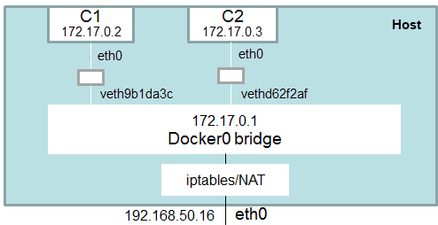

# Docker Networking

This chapter covers **networking** — how Docker containers communicate with each other, with the host, and with the outside world.

## Network Types

Docker supports several network drivers, each designed for different use cases:

| Driver      | Description | Use Case |
| ----------- | --- | --- |
| **bridge**  | Isolated virtual network for containers on the same host | Single-host container communication |
| **host**    | Container shares the host's network stack directly | Performance-sensitive apps; no port mapping needed |
| **none**    | Disables all networking | Security-sensitive containers that need no network access |
| **overlay** | Enables communication across multiple Docker hosts | Distributed apps with Docker Swarm or Kubernetes |

When Docker is installed, it automatically creates three networks:

```bash
docker network ls
```

```
NETWORK ID     NAME      DRIVER    SCOPE
93342291b315   bridge    bridge    local
78fab705d5af   host      host      local
16e8e5f990a0   none      null      local
```

## Bridge Network

The **bridge** driver is Docker's default. When you create a container without specifying a network, it connects to the default bridge network automatically. Containers on the same bridge can communicate with each other, and Docker provides NAT-based internet access so containers can reach the outside world.

### Default Bridge: Communication by IP

Create two containers on the default bridge:

```bash
docker run --name ubuntu1 -d -it ubuntu:22.04
docker run --name ubuntu2 -d -it ubuntu:22.04
```

Inspect the bridge to see their assigned IPs:

```bash
docker network inspect bridge -f '{{json .Containers}}'
```

Docker assigns IPs from the `172.17.0.0/16` subnet — for example, `172.17.0.2` for ubuntu1 and `172.17.0.3` for ubuntu2.

From inside ubuntu1, you can ping ubuntu2 by IP:

```bash
docker exec -it ubuntu1 bash
apt-get update && apt-get install -y iputils-ping
ping 172.17.0.3 -c 3
```

```
PING 172.17.0.3 (172.17.0.3) 56(84) bytes of data.
64 bytes from 172.17.0.3: icmp_seq=1 ttl=64 time=0.080 ms
64 bytes from 172.17.0.3: icmp_seq=2 ttl=64 time=0.101 ms
64 bytes from 172.17.0.3: icmp_seq=3 ttl=64 time=0.058 ms
```

### Default Bridge Limitation: No DNS

On the default bridge, Docker does **not** provide DNS resolution for container names:

```bash
ping ubuntu2
# ping: ubuntu2: Name or service not known
```

Containers must use IP addresses to communicate — which is fragile because IPs can change when containers restart. This is the main reason to use **user-defined bridge networks** instead.

### User-Defined Bridge Network

Create a custom bridge network:

```bash
docker network create -d bridge --subnet 172.18.0.0/16 my_net
```

Run two containers on it:

```bash
docker run --network my_net --name ubuntu3 -d -it ubuntu:22.04
docker run --network my_net --name ubuntu4 -d -it ubuntu:22.04
```

On a user-defined bridge, Docker provides **built-in DNS resolution** — containers can reach each other by name:

```bash
docker exec -it ubuntu3 bash
apt-get update && apt-get install -y iputils-ping
ping ubuntu4 -c 3
```

```
PING ubuntu4 (172.18.0.3) 56(84) bytes of data.
64 bytes from ubuntu4.my_net (172.18.0.3): icmp_seq=1 ttl=64 time=0.251 ms
64 bytes from ubuntu4.my_net (172.18.0.3): icmp_seq=2 ttl=64 time=0.162 ms
64 bytes from ubuntu4.my_net (172.18.0.3): icmp_seq=3 ttl=64 time=0.156 ms
```

This is why **user-defined bridges are preferred** over the default bridge for multi-container applications.

### Default vs User-Defined Bridge

| Feature | Default bridge | User-defined bridge |
| --- | --- | --- |
| DNS resolution (by container name) | ❌ No | ✅ Yes |
| Automatic container connection | ✅ Yes (all containers) | ❌ Must specify `--network` |
| Network isolation | Shared with all default containers | Isolated per network |

### Network Isolation and Connecting Across Networks

Containers on different bridge networks **cannot** communicate by default. This isolation helps secure and segment applications.

To connect a container to an additional network, use `docker network connect`:

```bash
docker network connect my_net ubuntu1
```

Now ubuntu1 (originally on the default bridge) can also communicate with containers on `my_net`.

## Bridge Internals

Understanding how bridge networking works under the hood helps with debugging and advanced configuration.

### `docker0` and veth Pairs

When Docker is installed, it creates a virtual Ethernet bridge called `docker0` on the host. This bridge acts as a virtual switch — all containers on the default bridge connect to it.



For each container, Docker creates a **virtual Ethernet (veth) pair**:

- One end connects to the `docker0` bridge (appears as `vethXXXX` on the host)
- The other end is moved into the container's network namespace (appears as `eth0` inside the container)

You can see these connections from the host:

```bash
brctl show docker0
```

```
bridge name     bridge id               STP enabled     interfaces
docker0         8000.02428bed1370       no              veth9b1da3c
                                                        vethd62f2af
```

Each `vethXXXX` interface corresponds to one container. A user-defined bridge (e.g., `my_net`) creates a separate bridge device (e.g., `br-ffaab08eb499`) with its own set of veth pairs.

### NAT and Port Forwarding

The `docker0` bridge connects containers to the outside world through **NAT** (Network Address Translation). Docker uses `iptables` rules to:

1. **Outbound traffic (masquerade):** When a container sends a packet to an external network, the packet goes through `docker0` → the host's network interface → the internet. NAT translates the container's IP to the host's IP, so external servers see the request as coming from the host.

2. **Inbound traffic (port forwarding):** When you use `-p 8080:80`, Docker creates an iptables rule that forwards traffic arriving on host port 8080 to container port 80.

View the NAT rules:

```bash
sudo iptables -t nat -L -n
```

### Connection to VM Networking

This architecture is nearly identical to how [libvirt](19_libvirt.md#networking) networks VMs — both use a Linux bridge, virtual interface pairs, and iptables NAT. The difference is the type of virtual interface:

| Concept | libvirt / QEMU (VMs) | Docker (Containers) |
| --- | --- | --- |
| **Virtual bridge** | `virbr0` | `docker0` |
| **Virtual interface pairs** | TAP devices (`vnet0`, `vnet1`) | veth pairs (`vethXXXX`) |
| **One end on the bridge** | TAP attached to `virbr0` | veth attached to `docker0` |
| **Other end in the guest** | TAP fd read by QEMU → VM sees `eth0` | veth moved into container namespace → `eth0` |
| **IP assignment** | `dnsmasq` DHCP on `virbr0` (192.168.122.x) | Docker IPAM (172.17.0.x) |
| **Outbound internet** | NAT via `iptables` (masquerade) | NAT via `iptables` (masquerade) |
| **Inbound access** | Not available without extra config | Port forwarding with `-p` via `iptables` |
| **Isolation** | VMs on different bridges are isolated | Containers on different bridges are isolated |

VMs use **TAP** devices because QEMU needs a Layer 2 interface to emulate a full NIC for the guest kernel. Containers use **veth** pairs because they share the host kernel — no hardware emulation is needed, just a virtual pipe between two network namespaces.

## Host Network

In **host** mode, the container shares the host's network stack directly — no bridge, no veth pairs, no NAT. The container uses the host's IP address and can bind to any port directly:

```bash
docker run --network host --name my-app -d nginx
```

With host networking:

- No port mapping needed (`-p` is ignored) — if nginx listens on port 80, it's accessible on port 80 on the host
- **Better performance** — no network translation layer, lower latency
- **No network isolation** — the container sees all host interfaces and ports
- **Port conflicts** — if the host is already using port 80, the container can't bind to it

Host networking is useful for performance-sensitive applications or tools that need to monitor the host's network traffic.

## None Network

The **none** driver disables all networking for the container:

```bash
docker run --network none --name isolated -d my-image
```

The container has only a loopback interface (`lo`) — no external communication is possible. This is used for security-sensitive workloads that process data without needing network access.

## Managing Networks

```bash
docker network ls                           # list all networks
docker network inspect bridge               # show network details (subnet, containers)
docker network create -d bridge my_net      # create a user-defined bridge
docker network connect my_net my-container  # connect a running container to a network
docker network disconnect my_net my-container  # disconnect from a network
docker network rm my_net                    # remove a network
docker network prune                        # remove all unused networks
```

---

[← Previous: Docker Volumes](30_docker_volumes.md) | [Next: Docker Internals →](32_docker_internals.md)
