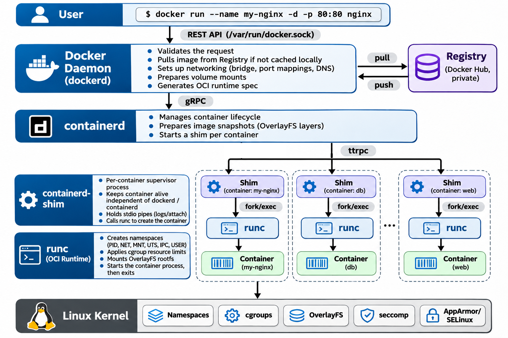

# Docker Internals

[Chapter 22](22_docker.md#docker-architecture) introduced Docker's client-server model at a high level — the CLI, the daemon, and how they communicate. This chapter goes deeper, tracing how Docker evolved from a monolithic engine into a modular, standards-based architecture, and explaining how each component works together today.

## Evolution of Docker's Architecture

### Early Docker (2013–2015)

When Docker launched in 2013, it was a single monolithic binary (`dockerd`) that handled everything: image building, networking, storage, logging, and container lifecycle. Under the hood, it used **LXC** (Linux Containers) as its runtime.

This made Docker easy to ship but hard to maintain — no standards for images or runtimes, no way for other tools to reuse Docker's components, and the entire engine ran as root.

### libcontainer (2014)

To remove the dependency on LXC, Docker created **libcontainer** — a Go library that interacted directly with Linux kernel primitives (cgroups, namespaces, capabilities, mount operations). This gave Docker full control over container creation without relying on external tools.

libcontainer later became the foundation for **runC**.

### Open Container Initiative (OCI) — 2015

As the container ecosystem grew (Docker, CoreOS, Red Hat, Mesosphere), the industry needed standards to prevent fragmentation. Docker and its partners created the **OCI** (Open Container Initiative), which defined two specifications:

| Specification | Defines |
| --- | --- |
| **OCI Image Spec** | Image format — layers, config, manifest |
| **OCI Runtime Spec** | How a container is created and managed — namespaces, cgroups, lifecycle |

Before OCI, every vendor had its own image format and runtime behavior. After OCI, images were portable across platforms and runtimes were interchangeable — enabling Kubernetes and cloud vendors to adopt containers confidently.

### runC (2015–2016)

Docker donated **runC** (a lightweight CLI wrapper around libcontainer) to the OCI as the **reference implementation** of the Runtime Spec. runC is a minimal, low-level runtime responsible only for creating and starting containers. Docker no longer needed to embed runtime logic inside its daemon — it could call runC as an external tool.

### containerd (2016–Present)

Docker split its engine into cleaner layers by extracting **containerd** — a daemon responsible for the full container lifecycle: pulling images, managing snapshots, creating containers, and delegating low-level execution to runC.

Docker donated containerd to the **CNCF** (Cloud Native Computing Foundation) in 2017. Today it is used far beyond Docker:

- **Kubernetes** (Docker support deprecated in v1.20, removed in v1.24; containerd is now the standard CRI runtime)
- AWS ECS, Google Container-Optimized OS
- Most cloud-native platforms

## Docker Engine Today

The modern Docker Engine is a stack of modular components. When you run `docker run`, this is the call chain:

### Component Summary

| Component | Role | Key Detail |
| --- | --- | --- |
| **Docker Client** | User interface (CLI) | Stateless; sends REST API requests to dockerd |
| **dockerd** | High-level orchestrator | Manages images, networks, volumes; delegates to containerd |
| **containerd** | Container runtime (high-level) | Manages lifecycle, snapshots; spawns a shim per container |
| **containerd-shim** | Per-container supervisor | Keeps containers alive independently of dockerd/containerd |
| **runC** | Container runtime (low-level) | Creates namespaces/cgroups, starts process, then exits |

### Docker Client

The CLI (`docker`) parses your commands, sends REST API requests to the daemon (typically over the Unix socket `/var/run/docker.sock`), and displays the results. It does not run containers itself — it's a stateless client that can even run remotely to control a Docker host on another machine.

### Docker Daemon (`dockerd`)

The daemon is the control plane of Docker. It exposes the Docker API, maintains system-wide state, and coordinates all high-level features: images, networks, volumes, builds, and Swarm mode. For actual container creation and execution, it delegates to **containerd** via gRPC.

### containerd

containerd is a lightweight, OCI-compliant runtime manager and the data plane of Docker. It handles pulling images, managing filesystem snapshots (OverlayFS layers), and orchestrating the full container lifecycle. For each container, containerd spawns a **shim** process rather than running the container directly.

containerd is fully **CRI-compliant** (Container Runtime Interface), which is why Kubernetes can use it directly — without Docker.

### containerd-shim

The shim is a small supervisor process that sits between containerd and the actual container. Every container gets its own shim. This design is critical because:

- **Decoupling** — Containers keep running even if containerd or dockerd restart (e.g., during upgrades)
- **runC can exit** — runC creates the container and exits immediately; the shim takes over as the container's parent process
- **I/O management** — The shim holds the container's stdio pipes, manages logging, and reports the exit code
- **Zombie reaping** — The shim reaps container processes when they exit

### runC

runC is the low-level OCI runtime that actually creates containers. It reads an **OCI bundle** (a config file + root filesystem), sets up the Linux kernel primitives (namespaces, cgroups, mounts, seccomp filters, capabilities), starts the container's initial process, and then **exits immediately** — leaving the shim as the container's supervisor.

runC is intentionally small and short-lived. It has no knowledge of Docker, Kubernetes, or images. It is the foundational runtime layer used by containerd, CRI-O, and most container systems in the industry.

---

[← Previous: Docker Networking](31_docker_network.md) | [Next: Docker Compose →](33_docker_compose.md)
