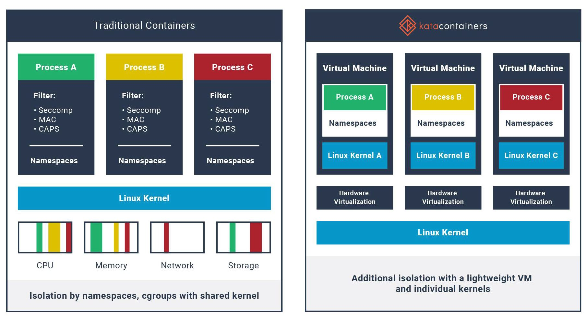
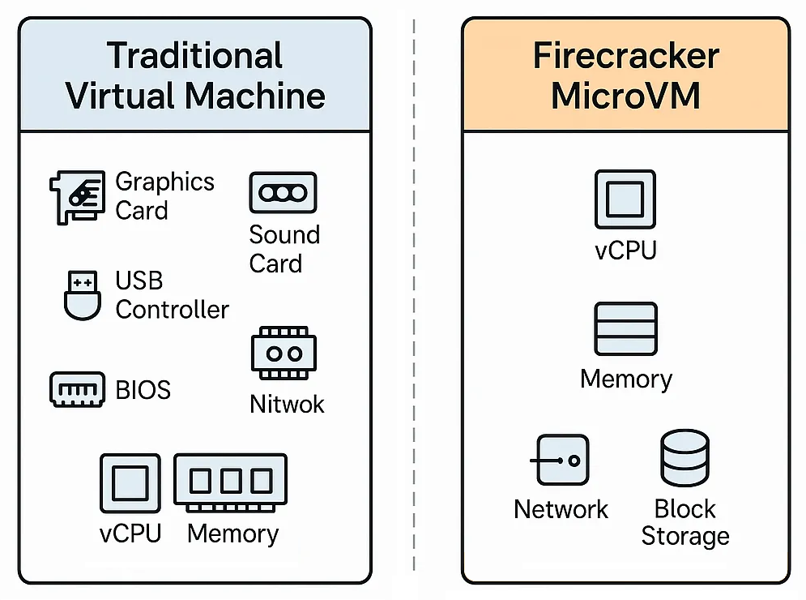
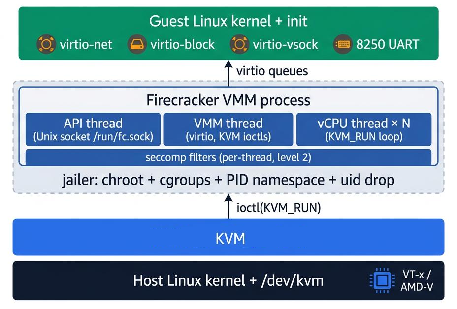

# Lightweight Virtualization

The primer has covered two approaches to isolating workloads: **virtual machines** ([Chapters 2–20](02_hardware_virtualization.md)) provide strong hardware-level isolation but carry the overhead of a full guest OS, and **containers** ([Chapters 21–33](21_os_virtualization.md)) are fast and lightweight but share the host kernel. This chapter introduces **lightweight virtualization** — technologies that aim to combine VM-level isolation with container-like speed and density.

## The Gap Between VMs and Containers

[Chapter 21](21_os_virtualization.md#vms-vs-containers) compared VMs and containers. The key trade-off is isolation vs. efficiency:

| Property | Traditional VMs | Containers |
|----------|----------------|------------|
| Isolation | Hardware-level (separate kernel) | Process-level (shared kernel) |
| Startup time | Seconds to minutes | Milliseconds to seconds |
| Overhead | High (full OS per VM) | Low (shared kernel) |
| Security boundary | Strong (hypervisor enforced) | Weaker (kernel shared with host) |

Containers are efficient, but sharing the host kernel means a kernel vulnerability can potentially compromise all containers on the host. VMs provide stronger isolation, but booting a full guest OS is slow and resource-heavy.

**Lightweight virtualization** fills the gap: isolate workloads with a hypervisor (like a VM), but strip away everything unnecessary so they start as fast as containers.

## The Landscape

Several projects have tackled this gap over the years, each with a different approach:

| Year | Project | Approach | Key Idea |
|------|---------|----------|----------|
| 2015 | **Intel Clear Containers** | Lightweight VM (KVM + kvmtool) | Each container in its own VM; sub-150 ms boot |
| 2016 | **Solo5 / ukvm** | Minimal unikernel monitor (KVM) | ~1,000-line monitor replacing QEMU; 10 ms boot |
| 2017 | **LightVM** | Lightweight VM (Xen) | Redesigned Xen control plane; 2.3 ms boot |
| 2017 | **Kata Containers** | OCI runtime (KVM + multiple VMMs) | Merged Clear Containers + runV; drop-in for runc |
| 2018 | **Firecracker** | Minimal VMM (KVM, Rust) | Coined **microVM**; powers AWS Lambda/Fargate |
| 2018 | **gVisor** | User-space syscall interception | No VM — reimplements syscalls in Go |

## Kata Containers

**Kata Containers** (2017) is the earliest widely-adopted project to bring lightweight VM isolation into the standard container ecosystem. It formed when Intel's **Clear Containers** (2015) merged with Hyper's **runV** — both projects shared the same vision: run each container inside its own lightweight VM with a dedicated kernel, instead of sharing the host kernel.



On the left, traditional containers all share the **same host kernel**. Isolation relies on software boundaries — namespaces, cgroups, and filters (seccomp, MAC, capabilities). If an attacker escapes these boundaries, they reach the shared kernel and can affect every container on the host.

On the right, Kata Containers wraps each process inside its own **lightweight VM with its own kernel**. Isolation is enforced by **hardware virtualization** — the same CPU-level boundary used by traditional VMs ([Chapter 3](03_type1_hypervisors.md)). Even if an attacker compromises one guest kernel, the other VMs remain isolated. Unlike a traditional VM, however, there is no full guest OS inside — just a minimal kernel and the container process. The user still runs `docker run` with standard container images, not VM disk images. That is what makes it "lightweight."

Kata is a **drop-in replacement for runc** — the OCI runtime described in [Chapter 32](32_docker_internals.md).

With standard Docker/containerd, the call chain is:

```
docker → containerd → runc → container (shared kernel)
```

With Kata Containers:

```
docker → containerd → kata-runtime → lightweight VM (dedicated kernel)
```

From the user's perspective, nothing changes — `docker run` works exactly as before. But under the hood, each container runs inside its own VM with a dedicated guest kernel, isolated by KVM ([Chapter 3](03_type1_hypervisors.md)).

Kata Containers supports multiple VMMs — all using KVM:

| VMM                  | Language | Notes |
|----------------------|----------|-------|
| **QEMU**             | C        | Most mature; GPU passthrough and confidential computing support |
| **Cloud Hypervisor** | Rust     | Lightweight; focused on performance and security |
| **Firecracker**      | Rust     | Minimal VMM; described in the next section |
| **Dragonball**       | Rust     | Built into the Kata runtime process for lowest overhead |

**Used in production by:** Baidu, Ant Financial (Alipay), and others running multi-tenant clusters where container-level isolation is not strong enough.

**Trade-off:** Because each container runs inside a real VM, Kata adds significant startup time (2–7 seconds depending on the VMM) and memory overhead (~180–300 MB per container) compared to runc. For long-lived workloads, the boot cost is paid once; for short-lived workloads, it is substantial.

## Firecracker

**Firecracker** (2018) is an open-source Virtual Machine Monitor (VMM) built by AWS in Rust. It powers **AWS Lambda** (serverless functions) and **AWS Fargate** (serverless containers) — handling billions of invocations per month.

While Kata Containers brought lightweight VMs into the container ecosystem using existing VMMs like QEMU, Firecracker took a different approach: build the most minimal VMM possible from scratch. Firecracker coined the term **microVM** — a lightweight virtual machine that strips away everything a cloud workload doesn't need. Instead of emulating a full PC (BIOS, USB, sound card, graphics), Firecracker provides only the handful of paravirtualized devices a cloud workload actually needs.



A Firecracker microVM has four key properties:

1. **KVM** provides the isolation — the same hardware virtualization covered in [Chapters 3](03_type1_hypervisors.md) and [11](11_qemu_and_kvm.md)
2. **Firecracker** replaces QEMU's hundreds of emulated devices with a handful
3. The guest boots its **own kernel** — unlike containers, which share the host kernel
4. The kernel is loaded **directly into memory** — no BIOS, no UEFI, no bootloader

This design solves a specific problem: **multi-tenant isolation**. Cloud providers like AWS need to run thousands of untrusted workloads on the same host. As discussed [earlier](#the-gap-between-vms-and-containers), sharing the host kernel means a single kernel vulnerability can compromise every container. Firecracker eliminates that risk by giving each workload its own kernel inside a microVM, while keeping the overhead tiny.

> **VMM vs. hypervisor:** [Chapter 2](02_hardware_virtualization.md) noted that the terms VMM and hypervisor are often used interchangeably — and in the Popek-Goldberg sense, they are synonyms. In modern terminology, the distinction matters: **KVM** is the hypervisor (kernel-space — virtualizes CPU and memory), while **Firecracker** is the VMM (user-space — emulates devices and manages the VM lifecycle). QEMU and Cloud Hypervisor are also VMMs; they all use KVM as the hypervisor underneath.

### Firecracker vs. QEMU

| Component        | QEMU ([Chapter 4](04_qemu.md))   | Firecracker |
|------------------|----------------------------------|-------------|
| Emulated devices | Hundreds (USB, sound, GPU, etc.) | 6 (virtio-net, virtio-block, virtio-balloon, virtio-vsock, serial, keyboard) |
| Boot time        | Seconds                          | ~125 ms |
| Memory overhead  | ~130 MB per VM                   | ~5 MB per VM |
| Code size        | Millions of lines                | ~50,000 lines of Rust |
| Attack surface   | Large (many emulated devices)    | Minimal |

### Architecture

The following diagram shows the Firecracker architecture:



Reading from the bottom up:

| Layer | Role |
|-------|------|
| **Host Linux kernel** | The host kernel with KVM and hardware extensions (VT-x / AMD-V) |
| **KVM** | The hypervisor — virtualizes CPU and memory ([Chapter 3](03_type1_hypervisors.md#why-kvm-is-classified-as-type-1)) |
| **jailer** | Confines each Firecracker process with chroot, cgroups, PID namespace, and uid drop |
| **Firecracker VMM process** | Three thread types: **API thread** (REST control via Unix socket), **VMM thread** (virtio device emulation), and **vCPU threads** (one per guest core, running the `KVM_RUN` loop) |
| **Guest Linux kernel + init** | A minimal guest OS that sees only the six paravirtualized devices listed above |

The `ioctl(KVM_RUN)` arrow between the VMM and KVM is the boundary between user-space and kernel-space — the vCPU threads enter guest mode through this interface.

## gVisor

**gVisor** (2018) is an open-source project by Google that takes a different approach. Instead of running a real VM with a guest kernel, gVisor interposes a **user-space application kernel** — a program called the **Sentry** that behaves like a kernel but runs as a normal process — between the application and the host kernel. It intercepts system calls and re-implements them so the application never talks to the host kernel directly. Its OCI runtime, `runsc`, is a drop-in replacement for runc.

| Approach | How It Isolates |
|----------|----------------|
| Traditional VM | Full guest kernel on virtualized hardware |
| Kata/Firecracker | Minimal guest kernel on KVM |
| gVisor | No guest kernel — syscalls handled in user-space |

For example, when an application calls `open()`, `read()`, or `write()`, the Sentry handles the call in Go rather than forwarding it to the host kernel. This dramatically reduces the host kernel's attack surface because the application can only reach the small set of syscalls that the Sentry itself uses internally.

gVisor is an **OCI-compatible runtime** (like runc and Kata), so it works with Docker:

```
docker → containerd → runsc (gVisor) → sandboxed process
```

**Used in production by:** Google Cloud for running untrusted multi-tenant workloads.

**Trade-off:** Because gVisor re-implements syscalls in user-space, there is a performance overhead for syscall-heavy workloads. Not all Linux syscalls are supported — applications that use exotic or rarely-used syscalls may not work.

## Unikernels

**Unikernels** take the concept furthest. In every technology covered so far, the application still sits on top of some form of kernel — whether a full OS, a minimal guest kernel, or a user-space kernel. Unikernels eliminate that separation: the application is compiled **together with only the OS components it needs** into a single bootable image.

A traditional stack vs. a unikernel:

```
Traditional:          Unikernel:
┌─────────────┐       ┌─────────────┐
│ Application │       │ Application │
├─────────────┤       │ + network   │
│   Libraries │       │ + filesystem│
├─────────────┤       │ + scheduler │
│ Full OS     │       └──────┬──────┘
│ (kernel +   │              │
│  userspace) │         Hypervisor
└──────┬──────┘
    Hypervisor
```

The result is a single-purpose image — often just a few MB — that boots in milliseconds and has an extremely small attack surface. There is no shell, no package manager, and no unused drivers — only the code the application actually calls.

Notable projects:

| Project | Language | Status |
|---------|----------|--------|
| **Unikraft** | C/C++, POSIX-compatible | Active, backed by Unikraft GmbH, EU research funding |
| **MirageOS** | OCaml | Mature, used for TLS/DNS services |
| **OSv** | Java, C | Runs unmodified Linux binaries on a minimal kernel |

**Trade-off:** Unikernels are harder to build and debug than containers. There is no shell to `exec` into, no `ps` or `top` to inspect processes. They excel for well-defined, single-purpose services but are impractical for general-purpose workloads.

## Comparison

| Technology | Isolation | Startup | Overhead | Compatibility | Production Use |
|------------|-----------|---------|----------|---------------|----------------|
| **Traditional VM** | Strongest (full hypervisor) | Seconds–minutes | High (~128+ MB) | Any OS | Universal |
| **Kata Containers** | Strong (KVM) | 2–7 s | ~180–300 MB | OCI (Docker) | Baidu, Ant Financial |
| **Firecracker** | Strong (KVM) | ~125 ms | ~5 MB | Linux guest | AWS Lambda/Fargate |
| **gVisor** | Strong (syscall interception) | Milliseconds | ~15 MB | OCI (Docker) | Google Cloud |
| **Unikernels** | Strong (hypervisor) | Milliseconds | ~1–10 MB | Single app only | Niche/specialized |
| **Containers** | Process-level | Milliseconds | ~1 MB | OCI (Docker) | Universal |

## When to Use What

| Scenario | Best Fit |
|----------|----------|
| Running different OSes on one host | Traditional VMs |
| Deploying microservices at scale | Containers |
| Multi-tenant isolation (untrusted workloads) | Firecracker, Kata Containers, gVisor |
| Serverless functions (short-lived, high-density) | Firecracker |
| Untrusted code execution | gVisor, Kata Containers |
| Single-purpose network appliances | Unikernels |

---

[← Previous: Docker Compose](33_docker_compose.md) | [Next: Network Virtualization →](35_network_virtualization.md)
